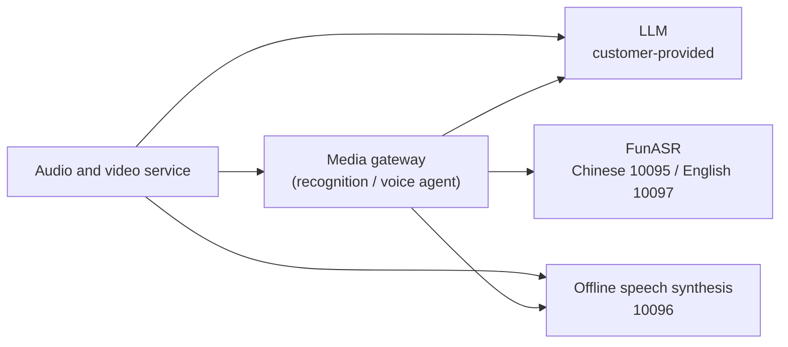

The AI capabilities need **a few more services** besides the platform: speech recognition, speech synthesis, and the customer's existing LLM.
The platform itself handles orchestration (whose speech goes to recognition, translation, and synthesis); all model inference runs in these services.

---

## Services to install

| Service | When it's needed | Provided by | Default port |
| --- | --- | --- | --- |
| Media gateway (speech recognition / voice agent module) | Captions, transcription, minutes, interpretation, voice agent | Platform component, included in the installation package | Internal API 8730 |
| Chinese speech recognition (FunASR) | Every scenario that uses speech recognition | Offline package provided with the installer, installed as an optional extension service | 10095 |
| English speech recognition (FunASR) | Interpretation, English captions, English voice agent | Separate offline image package from us | 10097 |
| Offline speech synthesis | Interpretation audio, voice agent | Separate offline image package from us (Chinese and English models) | 10096 |
| LLM | Translation, minutes, interpretation, voice agent | **Provided by the customer** (OpenAI-compatible API) | Decided by the customer |

All of these ports can be changed at deployment. Recognition and synthesis services are **for internal platform access only**; they don't need to, and shouldn't, be exposed to users.

---

## Resource reference

**CPU is enough; GPU is optional.** In this setup, speech recognition and offline speech synthesis both run on CPU; the LLM is usually deployed by the customer on their own GPU servers.
The table below shows data we measured or that was officially published; confirm actual capacity by load-testing on the on-site hardware.

| Service | Memory | CPU | Source |
| --- | --- | --- | --- |
| Chinese FunASR | — | Official figures: about 16 streams on 4 cores, about 32 on 16 cores, about 100 on 64 cores (one stream = one unmuted speaker) | FunASR official; **not load-tested by us** |
| English FunASR | About 1.1 GB resident | With 8 concurrent streams, about 0.23 cores on average and about 0.6 cores at peak, with no impact on latency | Measured by us |
| Offline speech synthesis | About 345 MB resident | With 4 threads: English real-time factor about 0.02 (about 0.14 seconds per sentence), Chinese about 0.14 (about 0.8 seconds per sentence) | Measured by us on a desktop-class x86 CPU |

+ **Real-time factor** (RTF) = synthesis time ÷ audio duration; smaller is faster. On server CPUs with lower single-core performance or in virtual machines, it may be about twice as slow, and Chinese synthesis gets tight
+ The number of concurrent recognition streams determines how many unmuted speakers can be transcribed at once; the media gateway opens one recognition connection per unmuted speaker
+ LLM call volume: live translation / interpretation makes one call per final sentence per target language; minutes make one call per meeting afterward (several for long meetings, in segments); the voice agent makes one call per conversation turn.
  When running many interpretation sessions, **confirm the LLM's concurrency capacity with the customer**, and set the "Concurrency limit" in the AI service accordingly
+ **Interpretation audio is cached in Redis**: each audio clip is kept for 10 minutes, and a sentence is usually tens to hundreds of KB. Approximate usage ≈ sentences per minute × size per sentence × number of target languages × 10 minutes × number of meetings with interpretation at the same time; leave headroom in Redis at deployment

---

## Which service calls which

| Caller | Calls | Purpose |
| --- | --- | --- |
| Media gateway | Speech recognition | Transcription, interpretation, voice agent |
| Media gateway | LLM, speech synthesis | Voice agent |
| Audio and video service | LLM | Live translation, minutes, interpretation translation |
| Audio and video service | Speech synthesis | Interpretation audio |

If the LLM is on another network segment of the customer's, allow access from these two servers to the LLM address.

---

## Reverse proxy paths to allow

If the customer has their own reverse proxy / gateway in front of the platform entry point, allow the following in addition to the usual API, signaling, and web paths:

| Path | Purpose | Notes |
| --- | --- | --- |
| `/aiapi/interp-audio/` | Interpretation audio download | Read cross-origin by web pages, so keep the CORS response headers returned by the server; if this path is missing, there are captions but no interpretation audio. See [Internal network and public internet](/en/product/deploy/networks#what-to-prepare-at-deployment) |
| The voice agent trial page path | AI voice agent | HTTPS required; the page pushes conversation state over SSE, so the reverse proxy must **disable response buffering** and use a long read timeout |

---

## Offline packages and installation

+ **Chinese FunASR**: the offline package includes the image and models and is installed as an extension service in the installer; when the media gateway is installed on the same machine, its address is filled in automatically
+ **English FunASR, offline speech synthesis**: we provide separate offline image packages (models included, runs without internet) and help install them on the customer's servers
+ **LLM**: provided by the customer. Once installed, register it in the admin console; see [AI services and profiles](/en/product/ai/models)

### Version requirements

| Feature | Required versions |
| --- | --- |
| AI services and profiles, simultaneous interpretation | Audio and video service 1.11.0+, meeting service 1.8.0+, media gateway 1.3.0+; for web clients, see [Simultaneous interpretation · Platform support](/en/product/ai/interpretation#platform-support) |
| AI voice agent | Media gateway 1.4.1+ |
