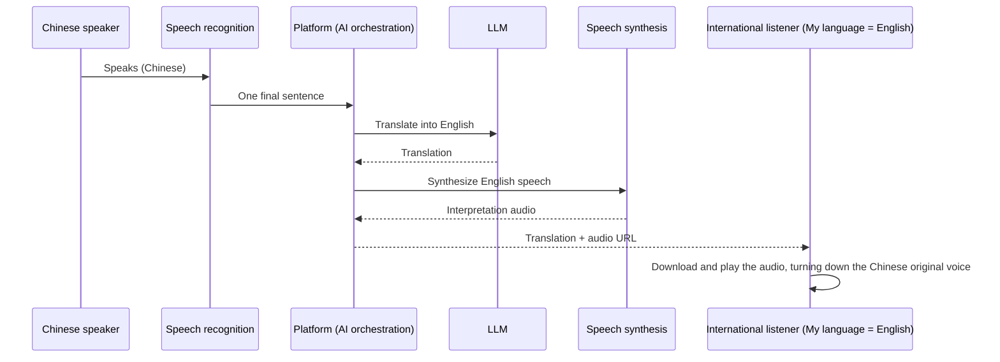

When Chinese and international participants meet, each person picks their own language and hears **interpretation audio** of what the other side says, with translated captions—no human interpreters and no extra equipment.

---

## How it works for users

1. **The host turns it on**: in the "Captions and transcription" panel of the web meeting, turn on "Simultaneous interpretation" (meeting transcription is turned on with it if it isn't already). The host or a co-host can turn it on and off
2. **Each member picks "My language"**: for example, the Chinese side picks Chinese and the international side picks English. It decides two things: **which language my speech is recognized in**, and **which language others' speech is translated into for me**.
   You can pick it even before interpretation is on
3. **During the meeting**: after the other side finishes each sentence, the system translates it into my language and plays synthesized speech to me; while interpretation audio plays, the speaker's original voice is turned down automatically (to 20% by default),
   and captions show the translation in my language
4. **Original audio only**: people who understand the other language or want the original speech turn on "Original audio only", and no interpretation audio is played; captions are unaffected

| Role | What they can do |
| --- | --- |
| Host / co-host | Turn simultaneous interpretation on and off |
| Every member | Set "My language", toggle "Original audio only" |
| Administrator (console) | Choose models, voice, and speaking rate, and adjust how far the original voice is turned down |

**Chinese ↔ English is currently supported**. Members who share a language get no translation—for example, a meeting where everyone speaks Chinese produces no interpretation audio even with interpretation on.

---

## How it works

+ Only **needed languages** are translated: each sentence is translated into "the languages of members in the meeting − the speaker's language"; languages nobody uses aren't translated
+ Each sentence is **synthesized only once** per target language, and everyone using that language downloads and plays the same audio
+ **Audio and video forwarding is unchanged**: interpretation audio is not a new audio track but an audio file sent along with a message, which each client downloads and plays itself. Meetings, recordings, and hardware endpoints are therefore unaffected
+ When several people speak at the same time, interpretation audio is **queued and played in turn** on each client rather than overlapping; when too much piles up, the oldest is dropped so playback doesn't fall further behind

---

## Latency (measured reference)

Interpretation **only starts translating after a sentence ends**, so interpretation audio always lags behind the original voice:

| Direction | From end of sentence to hearing interpretation |
| --- | --- |
| Chinese → English | About 2 seconds |
| English → Chinese | About 3–4 seconds |

We measured these on CPU servers with the platform's built-in recognition and offline speech synthesis; **they vary with server hardware, the speed of the LLM used, and sentence length**.
The time goes mainly to: waiting for the end-of-sentence pause to decide the sentence is over (about 0.8 seconds for English recognition), LLM translation, and speech synthesis (Chinese synthesis is slower than English).

---

## What needs configuring

| Setting | Where | Description |
| --- | --- | --- |
| Chinese and English speech recognition | **AI capabilities → AI services and profiles** | Under "Speech recognition" in the AI profile, choose one service per language (one recognition service each for Chinese and English) |
| LLM | Same place | Used for translation; **required**—interpretation can't be turned on without it |
| Speech synthesis | Same place | Choose a voice and set the speaking rate per language. **Without it, there are only translated captions and no interpretation audio** |
| Interpretation original-voice volume | "Interpretation original-voice volume" in the AI profile | How far the original voice is turned down while interpretation audio plays, 0–1, default 0.2; 0 mutes the original voice completely during interpretation audio |
| Reverse proxy allowlisting | At deployment | Interpretation audio is downloaded from the `/aiapi/interp-audio/` path; if a reverse proxy / gateway sits in front of the entry point, allow this path. See [Internal network and public internet](/en/product/deploy/networks#what-to-prepare-at-deployment) |

For how to connect models and which offline models are built in, see [AI services and profiles](/en/product/ai/models).

---

## Platform support

| Client | Support |
| --- | --- |
| Web meeting client | ✅ Interpretation switch, My language, Original audio only, interpretation audio playback, translated captions |
| SMeeting Web SDK | ✅ **From 0.3.9**, with a built-in interpretation player so your app doesn't handle the audio; see [SMeeting · Simultaneous interpretation](/en/meeting/web/api-reference/SMeeting#simultaneous-interpretation) |
| SRTC Web SDK | ✅ **From 0.7.7**, providing inserted audio playback and per-user volume; implement playback yourself from channel messages, see [Simultaneous interpretation messages](/en/rtc/web/channel-messages#simultaneous-interpretation-messages) |
| Meeting apps (Android / iOS), desktop, HarmonyOS, Mini Programs | ❌ Not supported yet; **Web only for now** |
| Meeting-room hardware endpoints, phones, cloud recording | ❌ Can't hear interpretation audio, and recordings don't contain it |

<Warning>
With interpretation on, each sentence is sent with multiple translations, one per language. **Older clients that don't recognize this field display all of them as captions**.
If the meeting includes members on other clients, make sure every client is upgraded to a version that supports interpretation before opening it to users.
</Warning>

---

## Known limitations

+ Interpretation audio lags the original voice by 2–4 seconds; see "Latency" above
+ English recognition only outputs whole sentences, so captions for English speakers don't appear as they speak
+ Interpretation audio uses a fixed voice, not the speaker's own voice
+ **People who mix Chinese and English should set "My language" to Chinese**: Chinese recognition can pick up English words mixed in, while English recognition can barely recognize Chinese
+ When several people speak continuously at the same time, translation and synthesis are queued; when the LLM's or speech synthesis's concurrency is full, that sentence gets text only or is skipped, so it doesn't fall further behind
