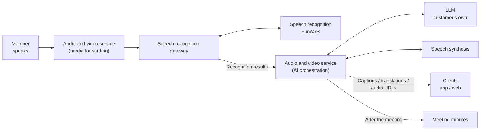

The platform's AI capabilities fall into two groups:

+ **AI in meetings and calls**: live captions, live translation, meeting minutes, simultaneous interpretation, and the AI voice agent. Recognition, translation, and synthesis all run on the **server**,
  so members don't install any plugins; results come back to every client as captions, minutes, and interpretation audio
+ **Audio and video AI processing on the device**: AI noise suppression, virtual background, and beauty filter. They run **locally** in the app or web page and don't go through the server

---

## Capabilities

| Scenario | What it does | Models needed | Where to configure / turn on |
| --- | --- | --- | --- |
| [Live captions and transcription](/en/product/ai/transcription) | Captions per speaker during the meeting; the full transcript is available afterward | Speech recognition | The host turns it on during the meeting; hot words in the admin console under **App AI settings** |
| [Live translated captions](/en/product/ai/transcription#live-translated-captions) | After each sentence ends, a translation appears below the caption | Speech recognition + LLM | Turn on live translation in **App AI settings**, or specify a target language when starting transcription |
| [Meeting minutes](/en/product/ai/summary) | Markdown minutes (summary, key points, decisions, action items) generated automatically when transcription ends | Speech recognition + LLM | Turn on automatic minutes and choose a minutes template in **App AI settings** |
| [Simultaneous interpretation](/en/product/ai/interpretation) | Each member picks "My language" and hears interpretation audio of what others say, with the original voice turned down | Speech recognition + LLM + speech synthesis | The host turns it on during the meeting; voice and original-voice volume in the **AI profile** |
| [AI voice agent](/en/product/ai/voice-agent) | Click "Start conversation" on a web page to talk with AI in real time by voice, and interrupt it at any time | Speech recognition + LLM + speech synthesis | Prompt, greeting, and voice in the **AI profile**; enable the voice agent on the media gateway |
| [Custom agents](/en/product/ai/voice-agent#build-your-own-agent) | Use the Python SDK to plug any recognition, LLM, or synthesis service into calls, including phone lines | Your choice | Up to your program |
| [AI noise suppression, virtual background, beauty filter](/en/product/ai/media-ai) | Remove keyboard and fan noise; blur or replace the background; smooth and brighten skin | On-device models | Client SDK APIs |

All models used by AI in meetings and calls are registered and combined in the admin console under **AI capabilities → AI services and profiles**. See [AI services and profiles](/en/product/ai/models).

---

## Two premises

**1. Fully self-hosted, offline deployment is possible.**
Speech recognition (FunASR) and speech synthesis come as ready-made offline images that run on CPU and are installed in the customer's data center along with the self-hosted deployment;
meeting audio, transcripts, and minutes stay inside the customer's internal network. The platform **has no public model endpoints built in**, so nothing is sent out unless you configure it.
For the resource usage and ports of each service, see [Deployment and resource planning](/en/product/ai/deploy).

**2. The LLM is the customer's own.**
The LLM used for translation, minutes, and the voice agent is not shipped with the platform; connect the customer's existing LLM service instead.
Anything with an **OpenAI-compatible API** works (DeepSeek, Qwen, self-hosted vLLM / Ollama, and more): fill in the address, model name, and key (leave the key empty for internal services without authentication).
Speech recognition and speech synthesis can likewise be replaced with services the customer already has. Keys are stored encrypted in the console, and the page only shows masked values.

<Note>
Without an LLM, live captions and transcription still work; live translation, meeting minutes, simultaneous interpretation, and the voice agent need an LLM.
</Note>

---

## How speech becomes captions, minutes, and interpretation audio

1. Once the host starts transcription, the **speech recognition gateway** enters the meeting as a listener and sends each unmuted speaker's voice to recognition **separately**, so captions always know who is speaking
2. Recognition results go back to the audio and video service: interim results are sent out directly as captions, and final sentences are archived
3. With translation or interpretation on, final sentences go to the **LLM** for translation; for interpretation, **speech synthesis** then generates the audio, which each client downloads and plays
4. When transcription ends, all final sentences of the session are assembled into a transcript and sent to the LLM to generate the **meeting minutes**

None of this changes audio and video forwarding itself: interpretation audio is not a new audio track but an audio file sent along with a message, so existing meetings and recordings are unaffected.

---

## Next steps

| I want to know about | Read |
| --- | --- |
| Captions, the full transcript, hot words, supported languages | [Live captions and transcription](/en/product/ai/transcription) |
| How minutes are generated, how to change templates, who can see them | [Meeting minutes](/en/product/ai/summary) |
| How to use interpretation, its latency, which clients support it | [Simultaneous interpretation](/en/product/ai/interpretation) |
| The AI voice agent, building your own agent, connecting phone calls to AI | [AI voice agent and custom agents](/en/product/ai/voice-agent) |
| Noise suppression, virtual background, and beauty filter support per platform | [Audio and video AI processing](/en/product/ai/media-ai) |
| How to connect models in the console, which open-source models are built in | [AI services and profiles](/en/product/ai/models) |
| How many server resources are needed, which ports to open | [Deployment and resource planning](/en/product/ai/deploy) |
