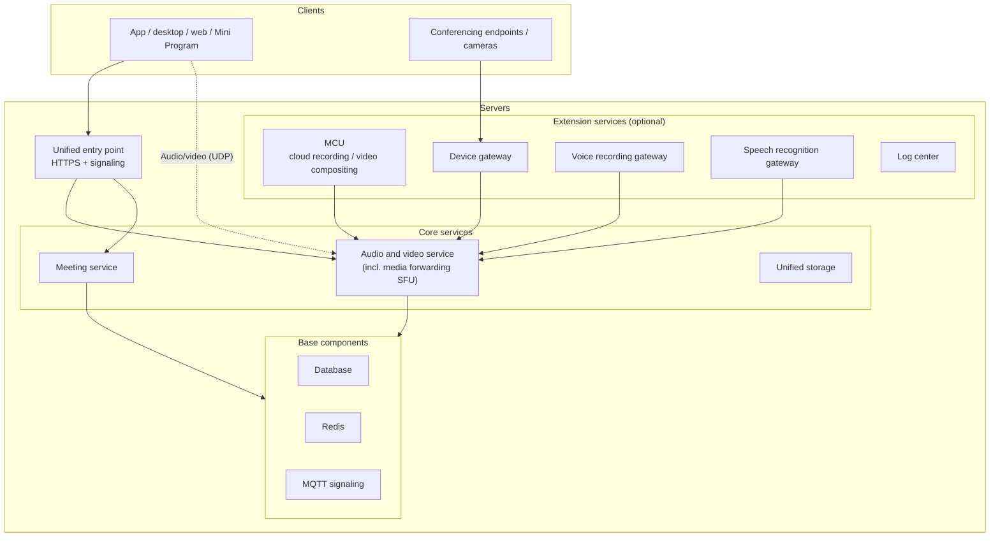

Our platform can be deployed entirely on the customer's own servers, with **fully offline installation** and no dependency on the internet. This page explains what an environment consists of,
to help you prepare servers and align the plan with the customer's network and security teams. For opening ports, see [Network and port requirements](/en/product/deploy/ports).

---

## Overall architecture

---

## Services

### Required

| Service | Role |
| --- | --- |
| Unified entry point (Nginx) | The external HTTPS entry point for APIs, the admin console, the web client, and signaling |
| Audio and video service | Channels, users, permissions, and media forwarding (SFU). The admin console is also here |
| Unified storage | Storage gateway for video recordings, audio recordings, and meeting attachments; works with local disks or object storage |
| Database | PostgreSQL; can also **reuse the customer's existing KingbaseES or Dameng** |
| Redis | Caching and state |
| MQTT signaling | Real-time signaling such as meeting control messages and member status |

### Optional

| Service | When to install |
| --- | --- |
| Meeting service | When using SMeeting meeting features (not needed if you use only SRTC audio and video) |
| MCU | When you need **cloud recording**, **video compositing**, **re-streaming**, or **connected SIP / H.323 endpoints need to see the meeting's video** |
| Device gateway | When connecting SIP / H.323 endpoints, GB28181 cameras, or RTSP streams; see [Device integration](/en/product/device-access/overview) |
| Voice recording gateway | When you need per-speaker segmented recording (audit trails for push-to-talk and dispatch) |
| Speech recognition gateway | When you need live captions or meeting minutes; the recognition engine is deployed separately |
| Log center | When you need to view client logs and call quality data centrally |
| Monitoring center | When you need to monitor server and service status |

---

## Installation

+ Deliverables are an **offline installation package** (with all service images) and a **web installer**
+ Run the installer on the server, open the installation page in a browser, and install **base components → core services → extension services** in order; each service is a card—fill in the parameters and install
+ The installer also handles later **upgrades**: import the new version's images and upgrade with one click on the page, with configuration merged automatically
+ After installation, import the **license file**; meetings work only once it's imported

<Note>
Close the installer once installation is done. It has permission to change configuration and restart services, so **never expose it externally**.
</Note>

---

## Environment requirements

| Item | Requirement |
| --- | --- |
| CPU architecture | x86_64 (amd64) and ARM64 (Kunpeng, Phytium, and others) |
| Operating system | Mainstream 64-bit Linux distributions, including Xinchuang operating systems; confirm specific versions with us |
| Runtime | Docker (the installer can install it with one click, no internet needed) |
| Database | PostgreSQL (bundled), KingbaseES, Dameng |
| Certificate | HTTPS certificate for the external domain (with the full certificate chain); on internal-only networks without a formal certificate you can use a self-signed one, but every client must trust the corresponding root certificate |

Server sizing depends heavily on concurrency, whether you record, and the number of devices; contact us for an assessment based on your actual scenario.

---

## Deployment topologies

| Topology | Description | Best for |
| --- | --- | --- |
| **Single server** | All services on one server | Testing, small to medium scale |
| **Split servers** | Extension services such as the MCU and device gateway deployed on separate servers | Heavy recording or device integration that needs isolated resources |
| **Multiple media nodes** | Several servers each run a media forwarding node, with users assigned by load or proximity | High concurrency, multiple regions |
| **Internal + public network planes** | One platform serves internal-network and public-network users at the same time | Government and enterprise internal networks plus remote work from the public network; see [Internal and public networks](/en/product/deploy/networks) |
| **Across an optical gateway** | The platform is on the internal network, and public-network users connect through an optical gateway | Strongly isolated networks for public security, procuratorates, courts, and government agencies; see [Access across an optical gateway](/en/product/deploy/optical-gap) |
