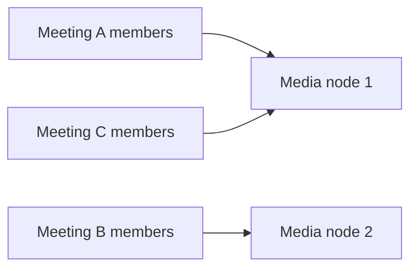
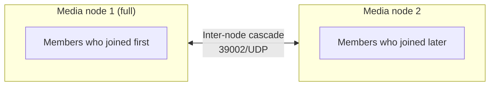
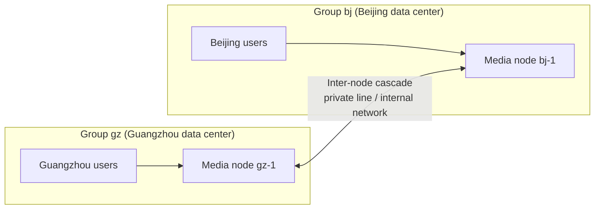

Audio and video media are forwarded by **media nodes** (SFUs). One server can only forward so much. For high concurrency,
or when users are spread across several data centers or regions, you can deploy multiple media nodes and let the platform assign users to nodes automatically.
For port requirements see [Network and port requirements](/en/product/deploy/ports); for the component layout see [Components and architecture](/en/product/deploy/architecture).

---

## Three assignment modes

| Mode | Effect | Suited to | Default |
| --- | --- | --- | --- |
| **Load-based assignment** | Each channel sits entirely on one node; new channels go to a less-loaded node | Many small and medium meetings or intercom sessions | On |
| **Overflow when full** | When a channel's node is full, later users go to other nodes, and the same meeting works across nodes | A single meeting may exceed what one server can carry | Off; enable as needed |
| **Nearest access** | Nodes are grouped by data center or region; users join a node in their own group, and users from different regions in the same meeting talk across nodes | Multiple regions or campuses, each with a local data center | Off; enable as needed |

The last two modes both result in **one channel spread across multiple nodes**. Nodes cascade media to each other automatically (forwarding only streams someone subscribes to),
which is transparent to users and your business system: neither clients nor business APIs need to change, and users still join the same channel.

### Load-based assignment (default)

+ When the first user joins a channel, the platform picks a less-loaded node among the available ones; everyone who joins that channel afterward goes to the same node
+ Load is assessed from the node's actual forwarding volume (packet rate), egress bandwidth, and CPU; nodes whose CPU exceeds the cutoff (default 90%) no longer receive new channels
+ When a node is full, new channels go to other nodes; **new users joining a channel already on that node are rejected**, and the client receives error code `1035` (media node at full capacity)

In this mode **the size of a single meeting is limited by what one node can carry**; scaling out increases how many meetings can run at the same time.

### Overflow when full

On top of the default mode, once the channel's node is full the platform no longer rejects later users; it assigns them to other nodes with spare capacity:

### Nearest access

Divide media nodes into **server groups** by data center or region. When your business system gets a channel join token for a user, it passes the user's group
(the `sg` parameter of [Get a channel join token](/en/rtc/server-api/channel#get-a-channel-join-token)),
and the platform assigns the user to a node in that group:

+ In the same meeting, Guangzhou users' streams are sent and received only on the Guangzhou node; only one inter-node cascade crosses regions, saving cross-region bandwidth
+ When a group has several nodes, users within the group are assigned by load; whether users overflow to other nodes in the group when its nodes are full depends on whether "Overflow when full" is also enabled
+ When the user's group **temporarily has no available node**, the platform assigns the user to a node in another group so they can still join
+ Your business system decides which group a user belongs to (for example, by the user's organization or campus); the platform doesn't infer it from the IP address

<Note>
Groups and [network lines](/en/product/deploy/networks) are different things: the group decides **which node** a user joins; the line decides **which address** the user uses to reach that node.
Nodes in the same group can also have both internal-network and public-internet lines.
</Note>

---

## Capacity and scheduling settings

In the admin console, go to **Operations management → Media nodes** and click "Scheduling settings" to edit. Changes take effect within 30 seconds after saving, with no service restart.
The node list on the same page shows each node's effective capacity limit, so you can confirm the settings took effect.

| Setting | Description |
| --- | --- |
| `channel_overflow` | Enable "Overflow when full" |
| `sg_affinity` | Enable "Nearest access" |
| `cpu_fuse_pct` | CPU cutoff percentage; above it, the node gets no new channels. Default 90 |
| `pps_per_core` | Full-load packet rate per core; node packet-rate limit = this value × number of cores. Default 20000 |
| `max_tracks` | Maximum number of streams a node carries, set per node; 0 = unlimited |
| `max_bandwidth_mbps` | Node egress bandwidth limit (Mbps), set per node; 0 = unlimited. One 720p stream is about 1.1 Mbps |

Capacity can be set per node, so servers with different specs can be deployed together, each with its own values.

<Warning>
Once a channel spans nodes, **streams cascaded in from other nodes also count toward this node's stream count**. So with overflow or nearest access enabled,
adding a node doesn't double capacity on the stream-count dimension; plan capacity mainly by bandwidth and CPU, and use `max_tracks` only as a backstop.
</Warning>

---

## Deployment prerequisites

+ **All media nodes share the same database and Redis** and are managed from the same admin console
+ **39002/UDP is open in both directions between nodes**, with very low packet loss (internal network in the same data center, or a private line). Confirm this before enabling overflow or nearest access; otherwise users on different nodes won't hear or see each other
+ **Keep network line settings consistent across nodes**: same line names, with each node filling in its own media address
+ **When several nodes share one public IP, give each node a different media port** (for example 39001 and 39011), map each port to its node on the firewall, and **keep port numbers unchanged**
+ **MCU, device gateway, voice recording gateway, and speech recognition gateway must be able to reach every media node's media port**: they join as members and connect to whichever node the channel is on. This is the one most often missed when opening ports
+ **Keep server clocks in sync (NTP)**: clock drift distorts call quality metrics; prepare a separate time source on self-hosted internal networks

---

## When a node fails

+ Once a node stops reporting heartbeats, the platform stops assigning new users to it; later joins and reconnects go to other online nodes
+ Users on the failed node disconnect and the client reconnects them to another node automatically; if the other nodes are also full, the client keeps retrying until capacity frees up
+ Plan capacity so that if one node fails, the rest can still carry the full load

---

## Limits

+ Inter-node cascading is designed for internal networks or private lines; **cascading between nodes over the public internet is not supported**
+ Your business system specifies the group for nearest access; the platform doesn't determine location by IP
+ For very large single sessions where a few people speak and many watch, MCU relay to live streaming for the audience is a better fit; contact us for an assessment
