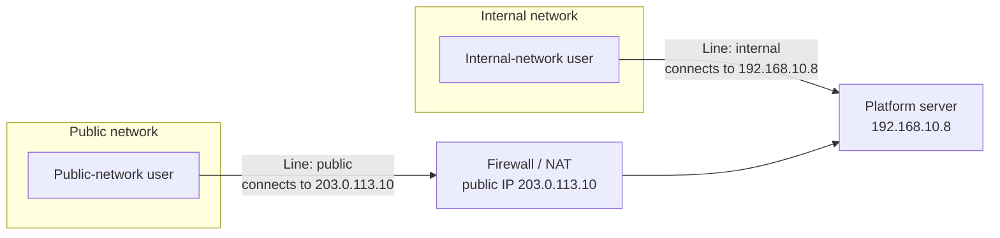

A common situation for government and enterprise customers: the platform is deployed in an internal data center, and internal staff access it directly; colleagues on business trips or working from home access it from the public network,
through a public address mapped out by the firewall. In the same platform and the same meeting, internal-network and public-network users must be able to talk to each other.

We solve this with **network lines**: the platform configures a separate set of "addresses clients should connect to" for each line.
When users enter a meeting they state which line they're on, and the platform gives them the matching addresses.

---

## What a network line is

Each line has two kinds of address:

| Address | Role | Ports |
| --- | --- | --- |
| Entry address | APIs, signaling, web access | 443/TCP, 18883/TCP |
| Media address | Audio and video | 39001/UDP |

Usually there are two lines: **internal** and **public**. You can configure more as needed (for example, a private network or another campus).

---

## What to prepare at deployment

1. **Addresses for each line**: the internal line uses the server's internal address; the public line uses the public IP or domain mapped out by the firewall
2. **Firewall mapping**: map the public line's 443/TCP, 18883/TCP, and 39001/UDP to the platform server, **keeping the same port numbers**
3. **Domain and certificate**: internal and public networks usually use different access addresses, and the certificate must cover the domain users actually access
4. **Choose the network mode in the installer**: internal only, public only, or both. After installation, you can view and change each line's entry address under **System configuration → Network** in the admin console

<Warning>
**Watch out for data centers whose inbound and outbound IPs differ**: in many data centers, the public IP users come in through isn't the IP the server uses to go out.
In that case you must explicitly set the public line's media address to **the public IP users come in through**; otherwise public-network users can enter meetings but get no video or audio.
</Warning>

---

## Putting users on the right line

The platform decides which set of addresses to give a user based on the "line" the user brings when entering the meeting. Your business system can do this in two ways:

+ **Let users choose**: the client lists "Internal / Public" and users pick one
+ **Decide on the server automatically**: based on the domain the user accessed, or whether the user's IP is an internal address

If no line is specified, the default is **internal**. For details and code examples, see the developer docs on [network lines](/en/rtc/network-line).

<Tip>
If "internal-network users are fine, but public-network users can enter meetings with no video", nine times out of ten the public-network users are being treated as the internal line, or the public line's media address is wrong.
</Tip>

---

## Relation to optical gateways

When internal and public networks are isolated by an **optical isolation gateway (network gatekeeper)** and firewall mapping isn't possible, the public line's addresses must point to the tunnel gateway on the outer side of the optical gateway;
see [Access across an optical gateway](/en/product/deploy/optical-gap).
