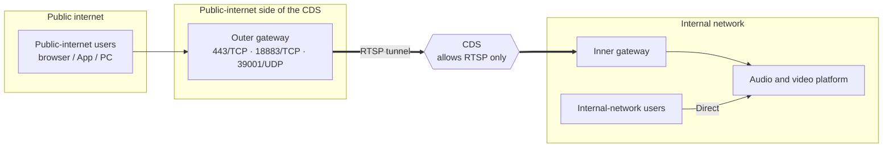
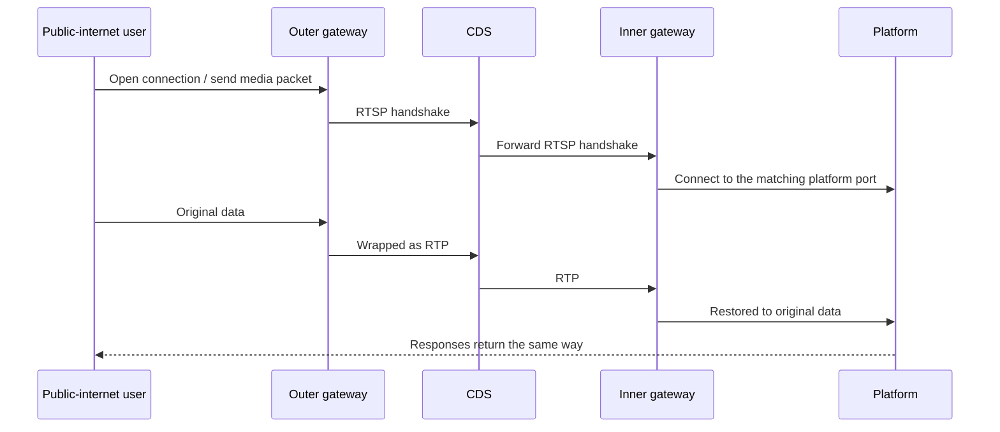

Public security bureaus, procuratorates, courts, government agencies, and similar organizations separate their internal network from the public internet with a **cross-domain solution (CDS)**, which controls what may pass between security domains. The CDS only allows specific business protocols
and doesn't let ordinary TCP / UDP pass through directly, so the audio and video platform's APIs, signaling, and media streams can't get across.

On site, the CDS usually already has an **RTSP video service** channel open. Our solution takes advantage of this: a **tunnel gateway** sits on each side of the CDS
and wraps the platform's traffic in standard RTSP sessions to cross it, restoring it on the other side. Users on the public internet and on the internal network can then talk to each other in the same meeting.

---

## Deployment architecture

| Component | Location | Role |
| --- | --- | --- |
| Outer gateway | Public-internet side of the CDS | Provides access ports for public-internet users and wraps traffic in RTSP sessions sent into the CDS |
| Inner gateway | Internal side of the CDS | Restores the RTSP sessions coming through the CDS into the original traffic and hands it to the platform |
| Audio and video platform | Internal network | Deployed normally; internal-network users access it directly |

---

## How it works

+ **APIs and signaling (TCP)**: for each connection a public-internet user opens, the outer gateway opens an RTSP session carried over RTSP over TCP, for reliable, ordered delivery
+ **Audio and video (UDP)**: when the outer gateway receives a user's first media packet, it opens an RTSP session carried over RTP over UDP, for real-time delivery
+ Once a session is established, traffic flows both ways, and the platform's responses return the same way

---

## Highlights

| Highlight | Description |
| --- | --- |
| Complies with CDS controls | Only standard RTSP / RTP crosses the CDS, so it only needs to allow the RTSP service—no general forwarding |
| End-to-end encryption | The gateways don't decrypt data; HTTPS, encrypted signaling, and encrypted media pass through as is, and certificates stay only on the internal platform |
| Transparent to the business | Neither the platform nor the clients need changes for the CDS; web, Android, iOS, and PC can all connect |
| Few channels | All users share one media port, so public-internet access needs only **3 channels** (one each for APIs, signaling, and media), regardless of user count |
| No extra relay | No separate TURN relay or media conversion service is needed |
| Internal-network and public-internet users in one meeting | Users on the public internet and on the internal network exchange audio and video in the same meeting |
| Session isolation | Each public-internet connection has its own RTSP session, reclaimed automatically when idle, with concurrency limits per port |

---

## Prerequisites

| Item | Requirement |
| --- | --- |
| Servers | One on each side of the CDS, running the outer gateway and the inner gateway respectively |
| Public address | The outer gateway needs an IP or domain reachable by public-internet users |
| CDS policy | Allow the RTSP control ports (for example, 3 TCP ports) and the RTP media port range (UDP, one pair per public-internet media connection, sized by concurrent public-internet users) between the two gateways. Specific ports are agreed with the CDS vendor during implementation |
| Public-internet-side ports | The outer gateway opens 443/TCP, 18883/TCP, and 39001/UDP externally, matching the platform ports |
| Internal-side connectivity | The inner gateway can reach the platform's 443/TCP, 18883/TCP, and 39001/UDP |
| Platform configuration | Deploy the platform with [internal-network and public-internet lines](/en/product/deploy/networks), with **the public-internet line's addresses pointing to the outer gateway** |
| License | The tunnel gateways need a separate license |
| Capacity | Size the gateways' concurrent sessions and the CDS's throughput by the number of concurrent public-internet members |

---

## Usage notes

<Warning>
**Users on the public internet must explicitly use the "public internet" line.** After passing through the gateways, the platform sees the gateway as the source address instead of the user,
so it can't tell the internal network from the public internet by IP. Your business system must keep users coming through the public-internet entry on the public-internet line (for example, by access domain); otherwise they enter meetings with no video.
</Warning>

+ **Content auditing**: data passes through encrypted end to end, and the CDS sees only the RTSP / RTP wrapping, not the business content. If the customer requires the CDS to audit content, discuss it in advance
+ **Source IP**: in platform logs, public-internet users' source addresses appear as the gateway address
+ **Capacity planning**: each public-internet user takes about 2 media sessions and 3–4 API connections; we recommend a load test before large-scale rollout
+ **Implementation**: CDS traversal is implemented per project and requires us, the customer, and the CDS vendor to agree on ports and policies; contact us
