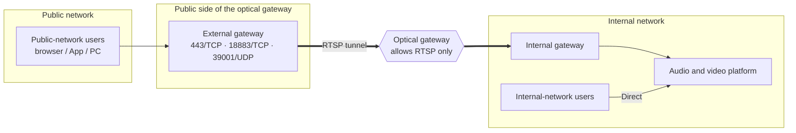
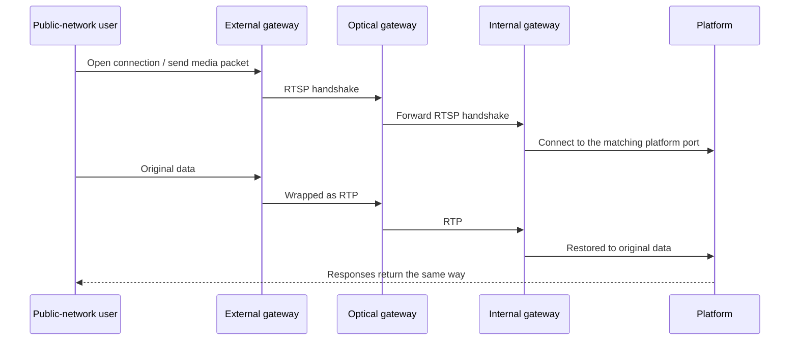

Public security bureaus, procuratorates, courts, government agencies, and similar organizations physically isolate their internal and public networks with an **optical isolation gateway (network gatekeeper)**. The optical gateway only allows specific business protocols
and doesn't let ordinary TCP / UDP pass through directly, so the audio and video platform's APIs, signaling, and media streams can't get across.

On site, the optical gateway usually already has an **RTSP video service** channel open. Our solution takes advantage of this: a **tunnel gateway** sits on each side of the optical gateway
and wraps the platform's traffic in standard RTSP sessions to cross it, restoring it on the other side. Public-network and internal-network users can then talk to each other in the same meeting.

---

## Deployment architecture

| Component | Location | Role |
| --- | --- | --- |
| External gateway | Public side of the optical gateway | Provides access ports for public-network users and wraps traffic in RTSP sessions sent into the optical gateway |
| Internal gateway | Internal side of the optical gateway | Restores the RTSP sessions coming through the optical gateway into the original traffic and hands it to the platform |
| Audio and video platform | Internal network | Deployed normally; internal-network users access it directly |

---

## How it works

+ **APIs and signaling (TCP)**: for each connection a public-network user opens, the external gateway opens an RTSP session carried over RTSP over TCP, for reliable, ordered delivery
+ **Audio and video (UDP)**: when the external gateway receives a user's first media packet, it opens an RTSP session carried over RTP over UDP, for real-time delivery
+ Once a session is established, traffic flows both ways, and the platform's responses return the same way

---

## Highlights

| Highlight | Description |
| --- | --- |
| Complies with optical gateway controls | Only standard RTSP / RTP crosses the optical gateway, so it only needs to allow the RTSP service—no general forwarding |
| End-to-end encryption | The gateways don't decrypt data; HTTPS, encrypted signaling, and encrypted media pass through as is, and certificates stay only on the internal platform |
| Transparent to the business | Neither the platform nor the clients need changes for the optical gateway; web, Android, iOS, and PC can all connect |
| Few channels | All users share one media port, so public-network access needs only **3 channels** (one each for APIs, signaling, and media), regardless of user count |
| No extra relay | No separate TURN relay or media conversion service is needed |
| Internal and public users in one meeting | Public-network and internal-network users exchange audio and video in the same meeting |
| Session isolation | Each public-network connection has its own RTSP session, reclaimed automatically when idle, with concurrency limits per port |

---

## Prerequisites

| Item | Requirement |
| --- | --- |
| Servers | One on each side of the optical gateway, running the external gateway and the internal gateway respectively |
| Public address | The external gateway needs an IP or domain reachable by public-network users |
| Optical gateway policy | Allow the RTSP control ports (for example, 3 TCP ports) and the RTP media port range (UDP, one pair per public-network media connection, sized by concurrent public-network users) between the two gateways. Specific ports are agreed with the optical gateway vendor during implementation |
| Public-side ports | The external gateway opens 443/TCP, 18883/TCP, and 39001/UDP externally, matching the platform ports |
| Internal-side connectivity | The internal gateway can reach the platform's 443/TCP, 18883/TCP, and 39001/UDP |
| Platform configuration | Deploy the platform with [internal and public lines](/en/product/deploy/networks), with **the public line's addresses pointing to the external gateway** |
| License | The tunnel gateways need a separate license |
| Capacity | Size the gateways' concurrent sessions and the optical gateway's throughput by the number of concurrent public-network members |

---

## Usage notes

<Warning>
**Public-network users must explicitly use the "public" line.** After passing through the gateways, the platform sees the gateway as the source address instead of the user,
so it can't tell internal from public by IP. Your business system must keep users coming through the public entry on the public line (for example, by access domain); otherwise they enter meetings with no video.
</Warning>

+ **Content auditing**: data passes through encrypted end to end, and the optical gateway sees only the RTSP / RTP wrapping, not the business content. If the customer requires the optical gateway to audit content, discuss it in advance
+ **Source IP**: in platform logs, public-network users' source addresses appear as the gateway address
+ **Capacity planning**: each public-network user takes about 2 media sessions and 3–4 API connections; we recommend a load test before large-scale rollout
+ **Implementation**: optical gateway traversal is implemented per project and requires us, the customer, and the optical gateway vendor to agree on ports and policies; contact us
