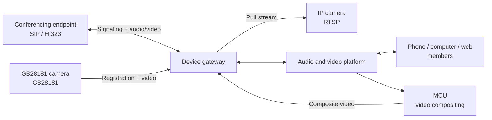

The hardware already in your meeting rooms—video conferencing endpoints from Huawei, Kedacom, and other brands, surveillance cameras on the wall, a video stream from an NVR—
can be in the same meeting as people on phones and computers, without replacing devices or installing apps. We call this capability **Room Connector**,
and the service behind it is the **device gateway**.

---

## What it can connect

| Device | Protocol | Typical scenarios | What it can do in the meeting |
| --- | --- | --- | --- |
| **Video conferencing endpoints** | SIP, H.323 | Meeting-room hardware endpoints, command-center displays, phones | **Two-way**: the endpoint's video and audio go into the meeting, and the meeting's video and audio come back to the endpoint |
| **Phone lines** | SIP | Carrier SIP trunks, IP-PBX, AI phone customer service, AI outbound calls, dialing in to meetings | **Two-way voice**: incoming calls join a channel and talk with AI or a person; see [Connect phone lines](/en/product/device-access/phone-lines) |
| **GB28181 surveillance cameras / NVRs** | GB28181 | Bringing public security, emergency response, and campus surveillance into consultations | **One-way**: camera video goes into the meeting, with remote PTZ control |
| **IP cameras / video streams** | RTSP | Any camera, encoder, or media server that can provide an RTSP URL | **One-way**: the video stream goes into the meeting |

Once in the meeting, a device is a regular member: its name is the "Display name" you entered when registering it, and it appears in the member list,
the video layout, and recordings just like everyone else.

---

## How it works

+ Devices only talk to the **device gateway**, which handles protocol conversion (SIP / H.323 / GB28181 / RTSP ↔ WebRTC)
  and then enters the meeting as a regular member
+ Conferencing endpoints see the **whole meeting composited by the MCU** (a multi-tile grid arranged by the meeting layout) and hear **the mixed audio of the whole meeting**.
  So for endpoints to see video, the platform must have the MCU (cloud recording gateway) deployed—when an endpoint enters, the platform automatically starts compositing for that meeting, with no manual step
+ Cameras and video streams only send video into the meeting; they don't receive the meeting's audio and video

---

## Protocol capabilities

| | SIP endpoint | H.323 endpoint | GB28181 | RTSP |
| --- | --- | --- | --- | --- |
| Device dials in to the meeting | ✅ | ✅ | — | — |
| Platform invites the device | ✅ | ✅ | ✅ | ✅ |
| Device registers to the platform | ✅ Optional | ✅ Optional (gateway has a built-in gatekeeper) | ✅ Required | — |
| Video into the meeting | ✅ | ✅ | ✅ | ✅ |
| Audio into the meeting | ✅ | ✅ | ✅ (if the device has audio) | ✅ (if the stream has audio) |
| Receives the meeting's video and audio | ✅ | ✅ | — | — |
| Video codec | H.264 | H.264 | H.264 (PS container) | H.264; H.265 is converted to H.264 automatically |
| Audio codec | G.711A | G.711A | G.711A | Common codecs; the gateway transcodes |
| PTZ / preset positions | — | — | ✅ (via server API) | — |

<Note>
**Dual-stream (secondary content stream) sharing** from endpoints isn't supported yet: a computer screen an endpoint shares over the secondary stream doesn't enter the meeting. To share content, share the screen from a meeting client.
</Note>

---

## Three ways to enter a meeting

**1. The device dials in**—dial the meeting number on the endpoint like a phone call:

+ Endpoint registered to the platform: dial the **meeting number** directly
+ Endpoint not registered: dial **`meetingNumber@deviceGatewayIP`**, for example `30332718@192.168.10.5`

**2. The platform invites the device**—the platform calls the device, and the endpoint rings like an incoming call (auto-answer can be set):

+ In the **admin console**, open the meeting details and click "Invite → Invite device"
+ In a **meeting client**, the host clicks "Invite → Invite device"
+ Your business system calls the **server API** to invite it; see [Device integration guide](/en/rtc/server-api/guides/agents)

**3. Registration or direct IP?** This decides how the platform finds the device:

| | Endpoint registration | Direct IP |
| --- | --- | --- |
| How | Create an account in the console; the endpoint registers to the device gateway with it | Register the endpoint's IP and port in the console |
| Platform sees online status | ✅ | ❌ |
| Device dials in | Meeting number only | Must dial `meetingNumber@gatewayIP` |
| Network requirement | **The device can reach the gateway**—works when the device is behind NAT | **The gateway must be able to reach the device's IP** |
| Recommendation | ✅ Preferred | Devices that don't support registration, or have a fixed IP |

GB28181 cameras support registration only, and RTSP streams support platform pull only.

---

## Prerequisites

| Item | Description |
| --- | --- |
| **Device gateway** | Installed as needed in self-hosted deployments; you can install several. When registering a device, choose which gateway it belongs to |
| **MCU** | Required for SIP / H.323 endpoints to see the meeting's video. Not needed if you only connect cameras and video streams |
| **License** | The device gateway needs its own license file; **each device in a meeting uses one user concurrency and one device concurrency** slot |
| **Network** | Open the SIP / H.323 / GB28181 signaling ports and the RTP port range between devices and the device gateway; see [Network and port requirements](/en/product/deploy/ports) |
| **Which app incoming device calls go to** | Configure a default app at deployment; from gateway 1.3.5, calls can be routed to different apps by called-number prefix; see [Connect phone lines](/en/product/device-access/phone-lines#which-app-incoming-calls-go-to) |

<Tip>
"Meeting number" means the meeting number of an SMeeting meeting. If you use only the SRTC audio and video layer without the meeting layer, devices dial the **channel name**,
so it's best to use channel names made of digits only, which endpoints can enter.
</Tip>

---

## Next steps

| I want to connect | Read |
| --- | --- |
| Meeting-room video endpoints | [SIP / H.323 endpoints](/en/product/device-access/sip-h323) |
| Phone lines (SIP trunk / IP-PBX) | [Connect phone lines](/en/product/device-access/phone-lines) |
| GB28181 surveillance cameras | [GB28181 cameras](/en/product/device-access/gb28181) |
| IP cameras, video streams | [RTSP streams](/en/product/device-access/rtsp) |
| Can't connect, no video | [FAQ](/en/product/device-access/faq) |
| Connecting devices from your business system via API | [Device integration guide](/en/rtc/server-api/guides/agents) |
