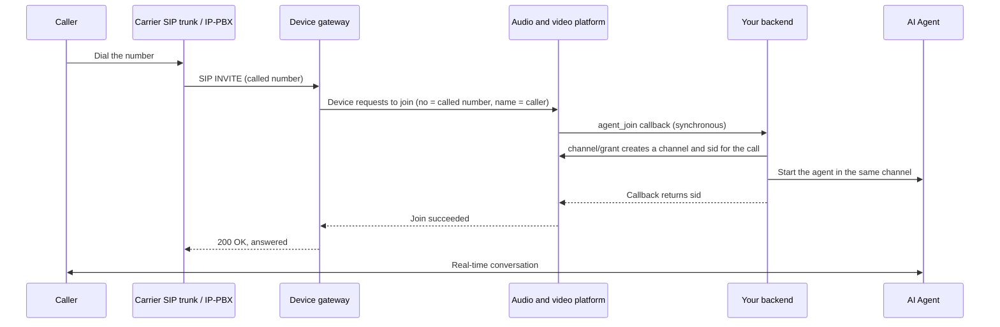

To the device gateway, a phone line is just a **SIP** connection, using the same capabilities as SIP conferencing endpoints: an incoming call is a regular user in the channel,
and can talk with a [SAI Agent](/en/rtc/python/advanced/pipecat) or enter an SMeeting meeting. **No dedicated telephony hardware is needed**—
a carrier SIP trunk or the customer's existing IP-PBX connects directly.

| Capability | Description |
| --- | --- |
| Inbound | Incoming calls join a channel through the gateway; your backend decides which channel (it can be a separate channel per call) |
| Outbound | Call the server API to [invite the device](/en/rtc/server-api/guides/agents#inviting-devices-and-controlling-them-in-the-channel), and the gateway calls the number |
| Routing by called number | The gateway routes incoming calls to different apps by called-number prefix, for example AI numbers to the AI app and the rest to the meeting app |
| DTMF | Supports RFC 4733 (telephone-event) and SIP INFO; keypresses reach the agent as in-channel custom messages |
| Audio codec | **G.711 A-law (PCMA) only**; select PCMA on the line side |
| Caller information | The caller ID is passed to your backend as the device name (`name`) |

<Note>
Routing by called number, DTMF forwarding, and immediately rejecting the incoming call when the platform declines it require **device gateway 1.3.5 or later**.
</Note>

---

## How it works



The key is the `agent_join` callback: the gateway only hands the called number (`no`) and caller (`name`) to the platform. **Your backend decides which channel the call joins and whether to answer it.**

---

## Three connection options

| Option | How | Best for |
| --- | --- | --- |
| **SIP trunk pointed at the gateway** | In the carrier's portal, set the number's inbound address to the gateway's public address and SIP port (IP peering) | You have a fixed public IP and buy numbers directly from a carrier |
| **Gateway registers upstream** | The gateway registers to the carrier or PBX with a SIP account (see `Reg` below), and the upstream forwards calls to it | The carrier requires registration authentication, or the gateway is behind NAT |
| **Through an existing IP-PBX** | The PBX forwards certain extensions / numbers to the gateway, and the rest work as before | The customer already has a call center and wants to hand some numbers to AI |

Dialing in to a meeting (entering the meeting number after the call connects) needs an IVR to collect digits, which the customer's PBX does before forwarding to the gateway; the gateway itself has no voice menu. AI calls don't need digit collection—the conversation starts as soon as the call connects.

---

## Gateway configuration

Configuration lives in the device gateway's `options.xml`; restart the gateway after changes.

### Listening and public address

```xml
<Sip enabled="true">
  <ListenPort>5060</ListenPort>
  <UseRtpAddress>true</UseRtpAddress>
</Sip>

<!-- The gateway's public address, written into SDP; the line side sends voice here -->
<NatAddress>203.0.113.10</NatAddress>

<Rtp>
  <Port begin="58000" end="59000" />
</Rtp>
```

Open the SIP port and RTP port range in the firewall; see [Network and port requirements](/en/product/deploy/ports).
When `UseRtpAddress` is `true`, the gateway sends voice back to the address the peer actually sends RTP from, so the peer can hear audio even behind NAT.

### Which app incoming calls go to

```xml
<Rtc>
  <!-- Default app: calls that match none of the routes below go here (for example, the SMeeting meeting app) -->
  <IncomingAppId>AppId of the meeting app</IncomingAppId>
  <!-- Route by called-number prefix; longest prefix wins -->
  <IncomingRoutes>
    <Route prefix="400" appid="AppId of the AI phone app" />
    <Route prefix="ai" appid="AppId of the AI phone app" />
  </IncomingRoutes>
</Rtc>
```

The prefix matches the called number. For carrier numbers, use the number itself (or its number block) as the prefix.

### Register to a carrier or PBX (optional)

```xml
<Sip enabled="true">
  <Reg enabled="true">
    <Address>sip.example-carrier.com</Address>
    <Port>5060</Port>
    <Transport>udp</Transport>
    <Username>Account assigned by the carrier</Username>
    <Password>Password assigned by the carrier</Password>
  </Reg>
</Sip>
```

### Incoming-call IP allowlist (required for public lines)

Once the SIP port is exposed to the internet, it keeps receiving scanning calls. The gateway has a built-in **automatic blocklist** (an IP is blocked after more than 5 attempts in 30 seconds),
so scans never reach the join flow. With a carrier line, the peer IP is fixed, so also turn on the allowlist to accept calls only from the line side:

```xml
<WhiteList enabled="true">
  <Ip>198.51.100.20</Ip>
  <Ip>198.51.100.0/24</Ip>
  <Ip>192.0.2.10-192.0.2.20</Ip>
</WhiteList>
```

Supports single IPs, IP ranges, and CIDR; IPv4 only.

---

## Your backend: one channel per call

On the AI phone app, [configure callbacks](/en/rtc/server-api/channel#configure-callbacks) and subscribe to `agent_join`. When the callback arrives:

1. Check whether it's a phone call: `type` is `2` (SIP), and `no` is the called number
2. Generate a unique channel name for the call, for example `phone-` plus a random string
3. Call [Get a channel join token](/en/rtc/server-api/channel#get-a-channel-join-token) with the `uid` from the callback to get the device's `sid`
4. Start the agent in the same channel asynchronously—**don't wait for the agent to join before returning**
5. Return `{"code": 0, "data": "<sid>"}` from the callback; any non-zero return rejects the call, and the gateway responds with 603

<Warning>
`agent_join` is a synchronous callback. The platform waits about 5 seconds, and a timeout counts as failure. Do slow work such as starting the agent and loading models after the callback returns.
</Warning>

For field descriptions and the response format, see the [Event callbacks guide](/en/rtc/server-api/guides/callbacks).

**The agent should only hear the phone's audio**: when the MCU is deployed, the platform publishes a composite stream (uid `__mcu__`) in the channel for SIP devices, and it **includes the agent's own voice**.
If the agent subscribes to all audio, filter by sender and feed only the device uid's audio (the `uid` in the `agent_join` callback) into speech recognition;
otherwise the agent hears itself and interrupts itself.

---

## DTMF

When the gateway receives a keypress, it sends a custom message to the channel **as the device**:

| Field | Value |
| --- | --- |
| `action` | `dtmf` |
| `content` | `{"digit": "5", "duration": 160}`; `digit` is `0`–`9`, `*`, `#`, or `A`–`D`, and `duration` is in milliseconds |
| Sender | Device uid |

In the Python SDK, receive it with `on_custom_msg`, for example to hand it to a pipecat pipeline:

```python
@transport.event_handler("on_custom_msg")
async def on_custom_msg(transport, msg):
    if msg.action != "dtmf" or msg.uid != device_uid:
        return
    digit = (msg.content or {}).get("digit")  # content is already parsed from JSON into a dict
    # For example, press 0 to reach a human: pass "the user pressed 0" to the LLM as an utterance, or run your own business logic
```

---

## Hang-up

- **The caller hangs up**: the device leaves the channel, and the agent ends the session when it receives the user-left event
- **Your side hangs up** (for example, after the AI says goodbye): call the [Remove a user from the channel](/en/rtc/server-api/channel#remove-a-user-from-the-channel) endpoint to remove the device uid from the channel, and the platform tells the gateway to send BYE on the line

---

## FAQ

| Symptom | Cause and fix |
| --- | --- |
| The call never connects and the line side eventually times out | First check whether the gateway log shows an INVITE; if not, check the firewall, allowlist, and the line side's inbound address |
| The call is rejected immediately (603) | Your backend's `agent_join` returned non-zero, or the channel name is invalid, or the callback timed out |
| No audio after connecting | The line-side codec isn't PCMA; or the RTP port range isn't open, or `NatAddress` is wrong |
| The AI keeps getting interrupted | Echo or background noise from the phone's speakerphone is recognized as the user barging in. Make sure the agent subscribes only to the device uid's audio, and raise the barge-in threshold for phone scenarios |

For SIP conferencing endpoint setup, see [SIP / H.323 endpoints](/en/product/device-access/sip-h323); for the AI side, see [pipecat integration](/en/rtc/python/advanced/pipecat).
