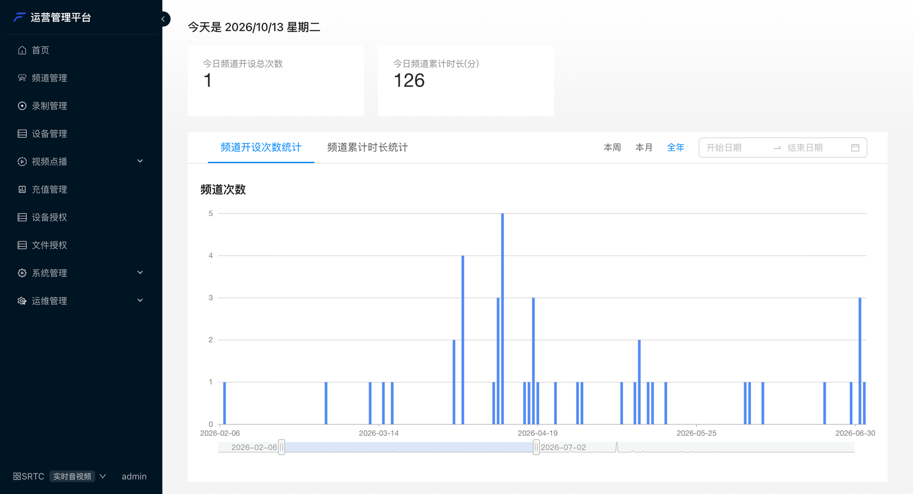
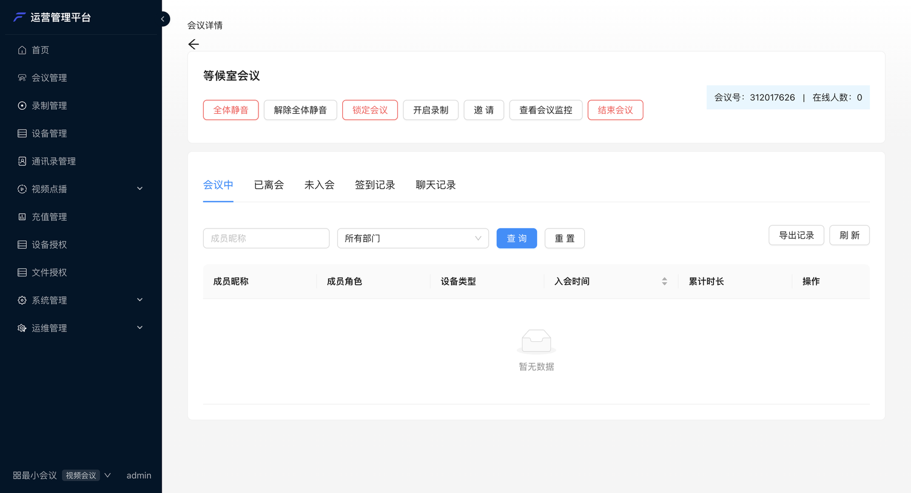
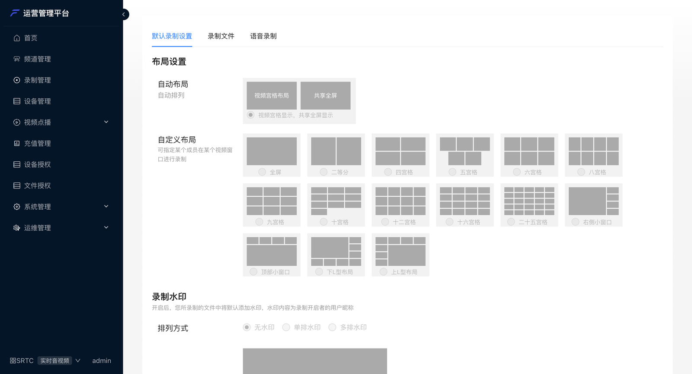
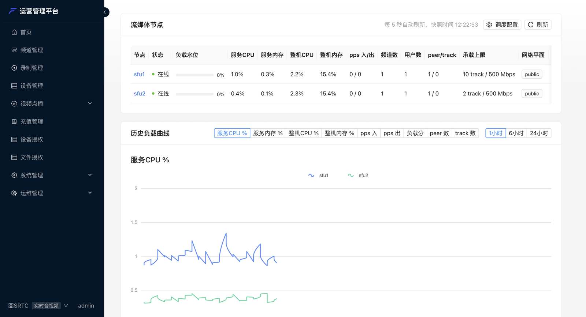
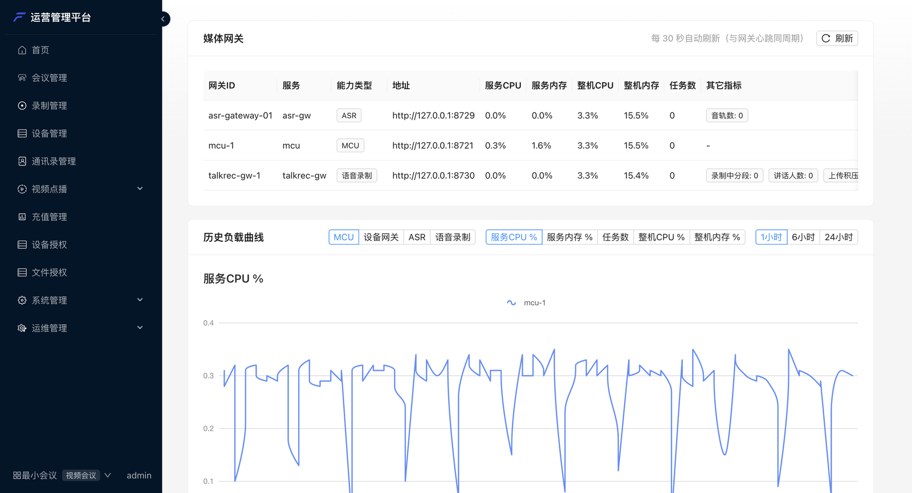

每套平台都自带一个 Web **管理后台**（部署后访问 `https://<你的域名>/admin/`），管理员不用写代码就能管理应用、
会议、录制、设备和服务器。左下角可以切换**应用**：音视频应用（SRTC）和会议应用（SMeeting）显示的菜单略有不同。

---

## 菜单一览

| 菜单 | 能做什么 | 应用类型 |
| --- | --- | --- |
| **首页** | 今日频道 / 会议次数与时长，按周、月、年看趋势 | 全部 |
| **频道管理** | 频道列表、在线人数、所在媒体节点，进入详情看成员与通话质量 | 音视频 |
| **会议管理** | 会议列表（即将召开 / 进行中 / 已结束）、预约会议、会议详情与会中管控 | 会议 |
| **录制管理** | 默认录制布局、水印、窗口标签；录制文件回放下载；语音录制 | 全部 |
| **设备管理** | 登记 SIP / H.323 终端、RTSP 视频流、国标摄像头，查看在线状态，见[设备接入](/zh/product/device-access/overview) | 全部 |
| **通讯录管理** | 部门与成员，供会议邀请使用 | 会议 |
| **视频点播** | 云端媒体库、云剪辑、云转码、转码模板、点播节点 | 全部 |
| **充值管理** | 查看本平台的平台码（申请授权时提供），给应用分配用户并发、设备并发和有效期 | 全部 |
| **文件授权** | 导入授权文件，查看各授权的总额度与剩余额度 | 全部 |
| **设备授权** | 客户端设备的激活记录与到期时间 | 全部 |
| **系统管理** | 后台账号、角色与菜单权限 | 全部 |
| **运维管理** | 客户端接入地址（网络线路）、媒体节点、媒体网关、MCU 告警、操作日志 | 全部 |

菜单按账号的角色权限显示，看不到某个菜单时请联系管理员分配权限。

---

## 会议管理与会中管控

进行中的会议可以直接在后台管控：**全体静音 / 解除静音、锁定会议、开启录制、邀请成员或设备、查看会议监控、结束会议**；
下方可以查看会中成员、已离会、未入会、签到记录和聊天记录，并导出。

---

## 录制管理

设置云录制的默认画面布局（自动宫格或指定成员的自定义布局，最多 25 宫格）、录制水印和窗口标签；
在「录制文件」中回放、下载录像；在「语音录制」中查看按人分段的录音。

---

## 运维管理

**媒体节点**：每个媒体转发节点的在线状态、负载水位、CPU / 内存、频道与用户数、所属网络线路，以及历史负载曲线。
多节点部署时也在这里调整调度策略。

**媒体网关**：MCU、设备网关、语音录制、语音识别等网关的运行状态、任务数与负载。

**系统配置 → 网络**：每条网络线路下发给客户端的接入地址，见[内外网与多线路](/zh/product/deploy/networks)。
