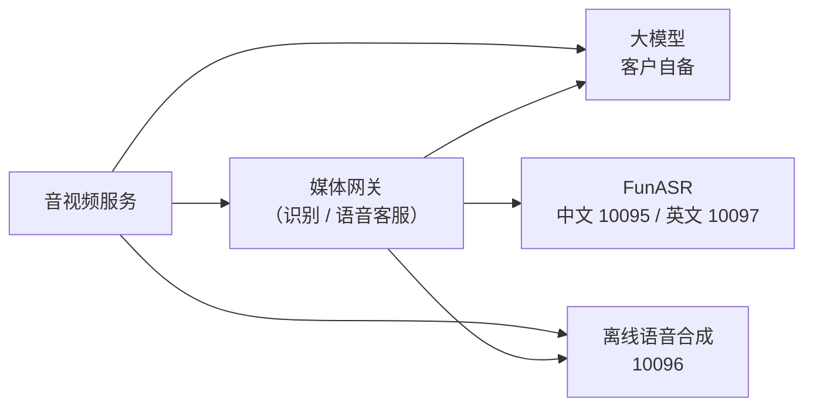

AI 能力在平台之外**多装几个服务**：语音识别、语音合成，以及客户已有的大模型。
平台本身负责编排（谁的话送去识别、翻译、合成），模型推理都在这些服务里。

---

## 要装哪些服务

| 服务 | 什么时候需要 | 由谁提供 | 默认端口 |
| --- | --- | --- | --- |
| 媒体网关（语音识别 / 语音客服模块） | 字幕、转写、纪要、同传、语音客服 | 平台组件，随安装包 | 内部接口 8730 |
| 中文语音识别（FunASR） | 用到语音识别的所有场景 | 离线包随安装器提供，作为可选扩展服务安装 | 10095 |
| 英文语音识别（FunASR） | 同传、英文字幕、英文语音客服 | 我方单独提供离线镜像包 | 10097 |
| 离线语音合成 | 同传要听译音、语音客服 | 我方单独提供离线镜像包（中英双模型） | 10096 |
| 大模型 | 翻译、纪要、同传、语音客服 | **客户自备**（OpenAI 兼容接口） | 由客户决定 |

以上端口均可在部署时修改。识别、合成服务**只给平台内部访问**，不需要、也不应对用户开放。

---

## 资源参考

**CPU 即可，GPU 可选。** 本方案的语音识别和离线语音合成都用 CPU 运行；大模型通常由客户在自己的 GPU 服务器上部署。
下表是我方实测或官方公布的数据，实际容量请按现场硬件压测确认。

| 服务 | 内存 | CPU | 数据来源 |
| --- | --- | --- | --- |
| 中文 FunASR | — | 官方数据：4 核约 16 路、16 核约 32 路、64 核约 100 路（一路 = 一个开麦的人） | FunASR 官方，**我方未压测** |
| 英文 FunASR | 常驻约 1.1 GB | 8 路并发时平均约 0.23 核、峰值约 0.6 核，延迟不受影响 | 我方实测 |
| 离线语音合成 | 常驻约 345 MB | 4 线程时：英文实时率约 0.02（一句约 0.14 秒），中文实时率约 0.14（一句约 0.8 秒） | 我方实测，桌面级 x86 CPU |

+ **实时率**（RTF）= 合成耗时 ÷ 音频时长，越小越快。服务器 CPU 单核性能较低或在虚拟机里时，速度可能慢一倍左右，中文合成会偏紧
+ 识别服务的并发路数决定能同时转写多少个开麦的人；媒体网关对每个开麦人建一条识别连接
+ 大模型的调用量：实时翻译 / 同传每句定稿、每种目标语言调用一次；纪要每场会后调用一次（长会议分段多次）；语音客服每轮对话一次。
  开很多场同传时要**向客户确认大模型的并发能力**，并在 AI 服务里设好「并发上限」
+ **同传译音暂存在 Redis**：每段译音保留 10 分钟，一句通常几十到几百 KB。大致占用 ≈ 每分钟句数 × 每句大小 × 目标语言数 × 10 分钟 × 同时开同传的会议数，部署时给 Redis 留出余量

---

## 服务之间谁访问谁

| 访问方 | 访问谁 | 用途 |
| --- | --- | --- |
| 媒体网关 | 语音识别 | 转写、同传、语音客服 |
| 媒体网关 | 大模型、语音合成 | 语音客服 |
| 音视频服务 | 大模型 | 实时翻译、纪要、同传翻译 |
| 音视频服务 | 语音合成 | 同传译音 |

大模型在客户另一个网段时，要放通这两台服务器到大模型地址的访问。

---

## 反向代理要放行的路径

平台入口前还有客户自己的反向代理 / 网关时，除常规的接口、信令、网页外，还要放行：

| 路径 | 用途 | 注意 |
| --- | --- | --- |
| `/aiapi/interp-audio/` | 同传译音下载 | 网页跨域读取，要保留服务端返回的跨域响应头；漏放时只有字幕、听不到译音。见[内外网与多线路](/zh/product/deploy/networks#部署时要准备什么) |
| 语音客服体验页的路径 | AI 语音客服 | 必须 https；页面用 SSE 推送对话状态，反向代理要**关闭响应缓冲**、读超时设长 |

---

## 离线包与安装

+ **中文 FunASR**：离线包里带镜像和模型，在安装器里作为扩展服务安装，同机安装媒体网关时会自动填好它的地址
+ **英文 FunASR、离线语音合成**：由我方单独提供离线镜像包（模型已打在包里，断网可运行），协助装在客户服务器上
+ **大模型**：客户自备。装好后在管理后台登记，见 [AI 服务与方案](/zh/product/ai/models)

### 版本要求

| 功能 | 需要的版本 |
| --- | --- |
| AI 服务与方案、同声传译 | 音视频服务 1.11.0+、会议服务 1.8.0+、媒体网关 1.3.0+；网页端见[同声传译 · 各端支持情况](/zh/product/ai/interpretation#各端支持情况) |
| AI 语音客服 | 媒体网关 1.4.1+ |
