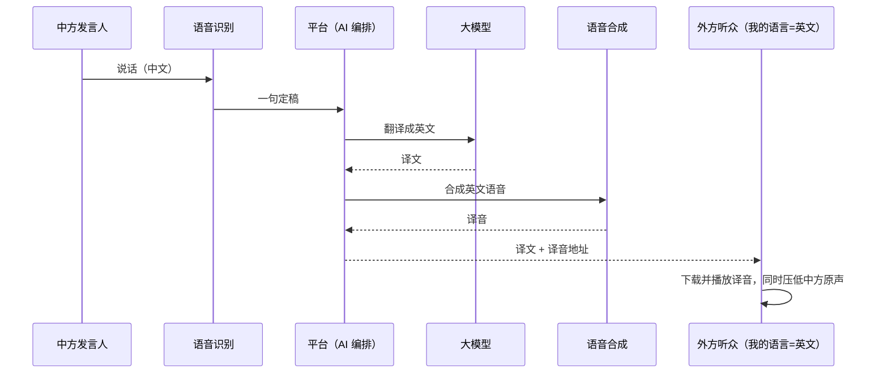

中外双方开会时，每个人选自己的语言，就能听到对方讲话的**译音**、看到译文字幕，不需要请同传译员，也不需要额外设备。

---

## 用起来是什么样

1. **主持人开启**：在网页会议「字幕与转写」面板打开「同声传译」（会议转写没开时会一起打开）。主持人或联席主持人可以开关
2. **每人选「我的语言」**：例如中方选中文、外方选英文。它决定两件事：**我说话按哪种语言识别**，**别人的话翻成哪种语言给我听**。
   同传没开时也可以先选好
3. **会中**：对方每说完一句，系统翻译成我的语言、合成语音播给我；播译音时说话人的原声自动压低（默认压到 20%），
   字幕显示我的语言的译文
4. **只听原声**：会外语或想听原话的人打开「只听原声」，就不播任何译音，字幕不受影响

| 角色 | 能做的事 |
| --- | --- |
| 主持人 / 联席主持人 | 开启、关闭同声传译 |
| 每个成员 | 设置「我的语言」、开关「只听原声」 |
| 管理员（后台） | 选模型、音色、语速，调原声压低的音量 |

**目前支持中英互译**。成员语言相同时不翻译，例如全员中文的会议开了同传也不会产生任何译音。

---

## 工作原理

+ 只翻译**需要的语言**：每句要翻成「在会成员的语言 − 说话人的语言」，没有人用的语言不翻
+ 每句话、每种目标语言只**合成一次**，所有用这种语言的人下载同一段译音播放
+ **不改音视频转发**：译音不是新的音轨，而是随消息下发的音频文件，各端自己下载播放。所以会议、录制、硬件终端都不受影响
+ 同一时间多个人说话时，译音在本端**排队依次播放**，不会叠在一起；积压太多时丢掉最旧的，避免越播越晚

---

## 延迟（实测参考）

同传是**一句说完才开始翻**，所以译音一定比原声晚：

| 方向 | 句尾到听见译音 |
| --- | --- |
| 中文 → 英文 | 约 2 秒 |
| 英文 → 中文 | 约 3～4 秒 |

这是我方在 CPU 服务器上、用本平台内置的识别与离线语音合成实测的结果，**会随服务器硬件、所用大模型的速度和句子长短变化**。
时间主要花在：等句尾停顿判定一句结束（英文识别约 0.8 秒）、大模型翻译、语音合成（中文合成比英文慢）。

---

## 需要配置什么

| 配置 | 在哪 | 说明 |
| --- | --- | --- |
| 中、英文语音识别 | **AI 能力 → AI 服务与方案** | AI 方案的「语音识别」按语言各选一个服务（中文、英文各一个识别服务） |
| 大模型 | 同上 | 用于翻译，**必配**；没配时无法开启同传 |
| 语音合成 | 同上 | 按语言选音色、设语速。**没配时只有译文字幕、没有译音** |
| 同传原声音量 | AI 方案「同传原声音量」 | 播译音时原声压到多少，0～1，默认 0.2；填 0 表示播译音时原声完全静音 |
| 反向代理放行 | 部署时 | 译音从 `/aiapi/interp-audio/` 路径下载，入口前有反向代理 / 网关时要放行，见[内外网与多线路](/zh/product/deploy/networks#部署时要准备什么) |

模型怎么接、内置了哪些离线模型见 [AI 服务与方案](/zh/product/ai/models)。

---

## 各端支持情况

| 端 | 支持情况 |
| --- | --- |
| 网页会议客户端 | ✅ 开关同传、我的语言、只听原声、译音播放、译文字幕 |
| SMeeting 会议 Web SDK | ✅ **0.3.9 起**，内置同传播放器，业务不用处理译音，见 [SMeeting · 同声传译](/zh/meeting/web/api-reference/SMeeting#同声传译) |
| SRTC 音视频 Web SDK | ✅ **0.7.7 起**提供插播音频和单人音量，按频道消息自己实现播放，见[同声传译消息](/zh/rtc/web/channel-messages#同声传译消息) |
| 会议 App（Android / iOS）、桌面端、鸿蒙、小程序 | ❌ 暂不支持，**目前仅 Web** |
| 会议室硬件终端、电话、云录制 | ❌ 听不到译音，录制里也没有译音 |

<Warning>
同传开启时每句会按语言下发多条译文，不认识这个字段的**旧版客户端会把它们都当字幕显示**。
会议里有其它端的成员时，先确认各端已升级到支持同传的版本，再对用户开放同传。
</Warning>

---

## 已知限制

+ 译音比原声晚 2～4 秒，见上文「延迟」
+ 英文识别只出整句，英文发言人的字幕不会边说边出
+ 译音是固定音色，不是发言人本人的声音
+ **中英夹杂的人请把「我的语言」设为中文**：中文识别能认出夹杂的英文单词，英文识别基本认不出中文
+ 多人同时连续发言时，翻译和合成会排队；大模型或语音合成并发满了时，这一句只有文字或直接跳过，不会越积越晚
