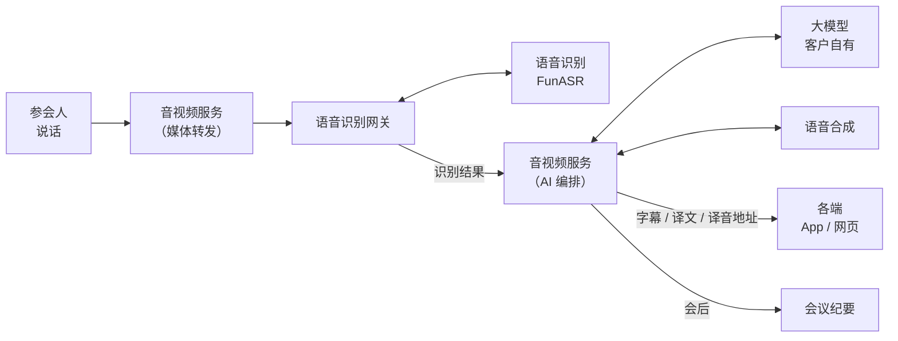

平台的 AI 能力分两类：

+ **会议与通话里的 AI**：实时字幕、实时翻译、会议纪要、同声传译、AI 语音客服。识别、翻译、合成都在**服务端**完成，
  参会人不用装插件，结果以字幕、纪要、译音的形式回到各端
+ **终端上的音视频 AI 处理**：AI 降噪、虚拟背景、美颜。在 App、网页**本地**运行，不经过服务器

---

## 能力清单

| 场景 | 效果 | 依赖什么模型 | 在哪配置 / 开启 |
| --- | --- | --- | --- |
| [实时字幕与转写](/zh/product/ai/transcription) | 会中按说话人出字幕，会后可查整场转写原文 | 语音识别 | 主持人在会中开启；热词在管理后台「应用 AI 设置」 |
| [实时翻译字幕](/zh/product/ai/transcription#实时翻译字幕) | 每句话说完后在字幕下方给出译文 | 语音识别 + 大模型 | 「应用 AI 设置」打开实时翻译，或开启转写时指定目标语言 |
| [会议纪要](/zh/product/ai/summary) | 转写结束后自动生成 Markdown 纪要（概要、要点、决议、待办） | 语音识别 + 大模型 | 「应用 AI 设置」打开自动生成纪要、选纪要模板 |
| [同声传译](/zh/product/ai/interpretation) | 每人选「我的语言」，听到的是别人讲话的译音，原声压低 | 语音识别 + 大模型 + 语音合成 | 主持人在会中开启；音色、原声音量在「AI 方案」 |
| [AI 语音客服](/zh/product/ai/voice-agent) | 网页上点「开始对话」就能和 AI 实时语音对话，可随时插话打断 | 语音识别 + 大模型 + 语音合成 | 「AI 方案」填提示词、开场白、音色；媒体网关开启语音客服 |
| [自研智能体](/zh/product/ai/voice-agent#自己开发智能体) | 用 Python SDK 把任意识别 / 大模型 / 合成接进通话，也可接电话线路 | 自选 | 由你的程序决定 |
| [AI 降噪、虚拟背景、美颜](/zh/product/ai/media-ai) | 去掉键盘声、风扇声；背景虚化或替换；磨皮美白 | 终端本地模型 | 客户端 SDK 接口 |

会议与通话里的 AI 用到的模型都在管理后台 **AI 能力 → AI 服务与方案** 里登记和组合，见 [AI 服务与方案](/zh/product/ai/models)。

---

## 两个前提

**1. 可以完全私有化、离线部署。**
语音识别（FunASR）和语音合成有现成的离线镜像，用 CPU 就能跑，随私有化部署一起装在客户机房里；
会议音频、转写文字、纪要都只在客户内网流转。平台**不内置任何公网模型地址**，不配置就不会往外发数据。
各服务的资源占用与端口见 [部署与资源规划](/zh/product/ai/deploy)。

**2. 大模型用客户自己的。**
翻译、纪要、语音客服用到的大模型不随平台提供，接入客户已有的大模型服务即可：
只要是 **OpenAI 兼容接口**（DeepSeek、通义千问、私有部署的 vLLM / Ollama 等）都能接，填地址、模型名、密钥（内网无鉴权的可不填）。
语音识别、语音合成同样可以换成客户已有的服务。密钥在后台加密存储，页面上只显示打码后的值。

<Note>
不配大模型时，实时字幕和转写照常可用；实时翻译、会议纪要、同声传译、语音客服需要大模型。
</Note>

---

## 一句话是怎么变成字幕、纪要和译音的

1. 主持人开启转写后，**语音识别网关**以旁听身份入会，把每个开麦人的声音**分开**送去识别，所以字幕天然知道是谁说的
2. 识别结果回到音视频服务：中间结果直接作为字幕下发，整句定稿后存档
3. 开了翻译或同传时，定稿句交给**大模型**翻译；同传再交给**语音合成**生成译音，各端下载播放
4. 转写结束后，整场定稿句拼成逐字稿交给大模型，生成**会议纪要**

整个过程不改音视频转发本身：同传的译音不是新的音轨，而是随消息下发的音频文件，所以对现有会议、录制没有影响。

---

## 下一步

| 我想了解 | 看这篇 |
| --- | --- |
| 字幕、转写原文、热词、支持哪些语言 | [实时字幕与转写](/zh/product/ai/transcription) |
| 纪要怎么生成、模板怎么改、谁能看 | [会议纪要](/zh/product/ai/summary) |
| 同传怎么用、延迟多少、哪些端支持 | [同声传译](/zh/product/ai/interpretation) |
| AI 语音客服、自己开发智能体、电话接 AI | [AI 语音客服与智能体](/zh/product/ai/voice-agent) |
| 降噪、虚拟背景、美颜各端支持情况 | [音视频 AI 处理](/zh/product/ai/media-ai) |
| 后台怎么接模型、内置了哪些开源模型 | [AI 服务与方案](/zh/product/ai/models) |
| 服务器要多少资源、开哪些端口 | [部署与资源规划](/zh/product/ai/deploy) |
