我们准备了两套网页演示，打开浏览器就能体验，不用安装任何东西。
**体验地址与账号请[联系我们](https://www.stmlink.com/contact)获取**，我们会为你开通独立的体验账号。

---

## 会议演示

基于 SMeeting 会议 SDK 做的完整会议产品，适合评估会议功能和交互。它也就是
[带 UI 极简对接](/zh/meeting/ui-sdk/server-integration)里可以直接嵌入你系统的那套界面。

### 会前

登录后的首页：加入会议、即时会议、预约会议三个入口，左侧是今天的会议和历史会议。

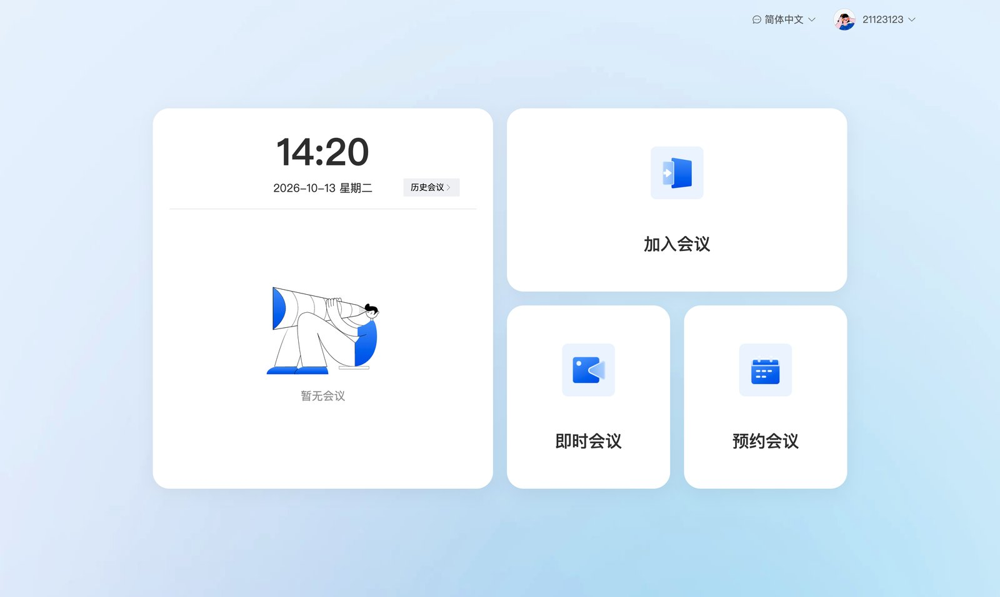

**预约会议**：设置会议名称、开始时间、时长、会议模式，上传会议资料，从通讯录选择与会人员；
高级选项里可以开启「仅限受邀人参与」「会议等候室」「允许成员在主持人之前入会」和会议密码。

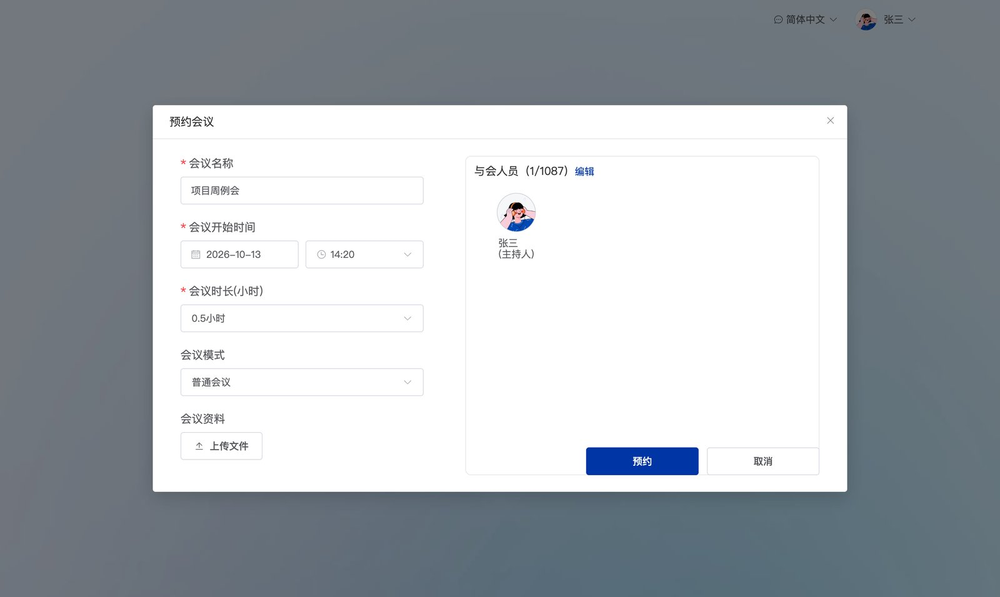

**即时会议**：起个名字，选好入会时是否开麦克风、摄像头、扬声器，立即开会。

### 会中

底部工具栏：扬声器、麦克风、摄像头、共享屏幕、录制、成员、聊天、分组讨论、邀请、签到、设置；
左上角可以锁定会议、查看质量监测，右上角切换布局。

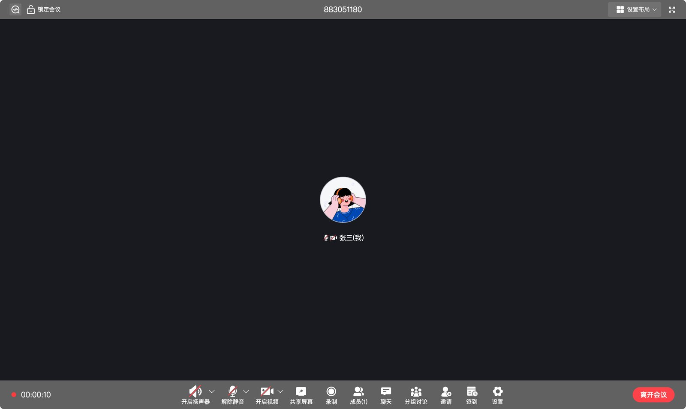

**成员管理与权限**：按「等候室 / 会议中 / 未入会」查看成员，主持人可以全体静音、解除全体静音，
设置是否允许成员自行开麦、开视频，以及谁能共享屏幕。

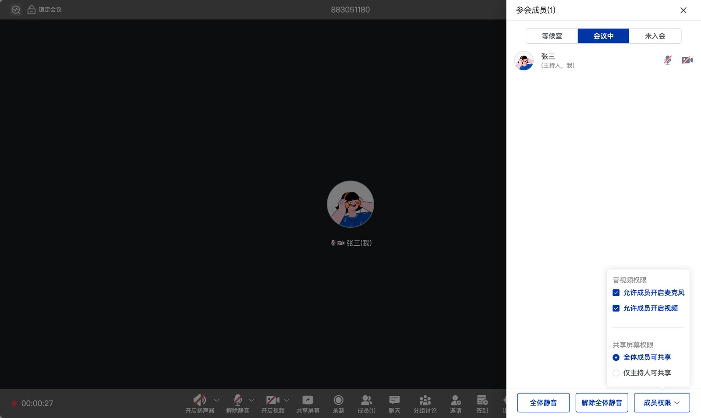

**邀请**：从通讯录按部门邀请成员（对方收到入会提醒），或者切到「邀请设备」，把会议室终端、监控摄像头拉进会议
（设备接入见[会议室连接器](/zh/product/device-access/overview)）。

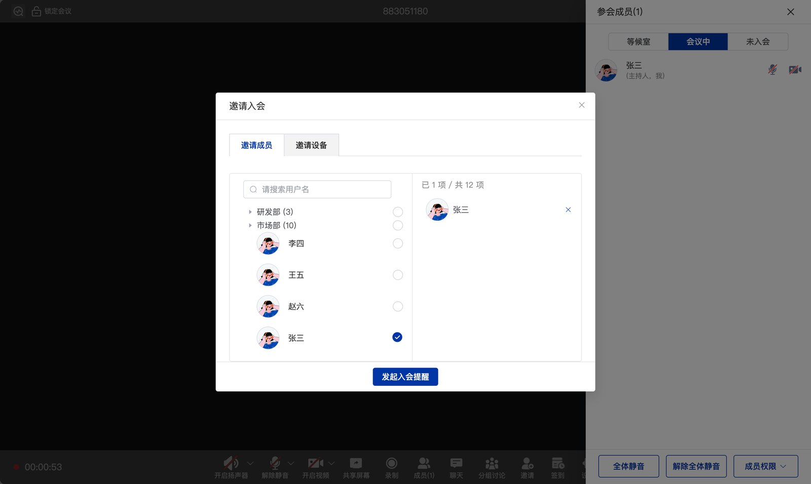

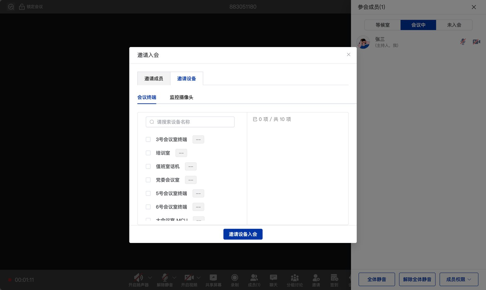

**聊天**：会中文字聊天，支持发送文件。

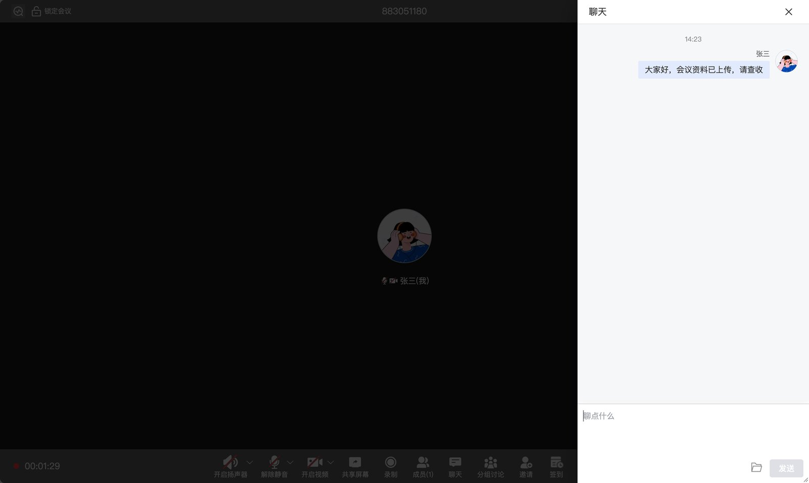

**布局**：宫格视图（默认、全屏、二等分、四宫格、五宫格……）和大小画面视图（右侧小窗口、顶部小窗口、L 型布局）。

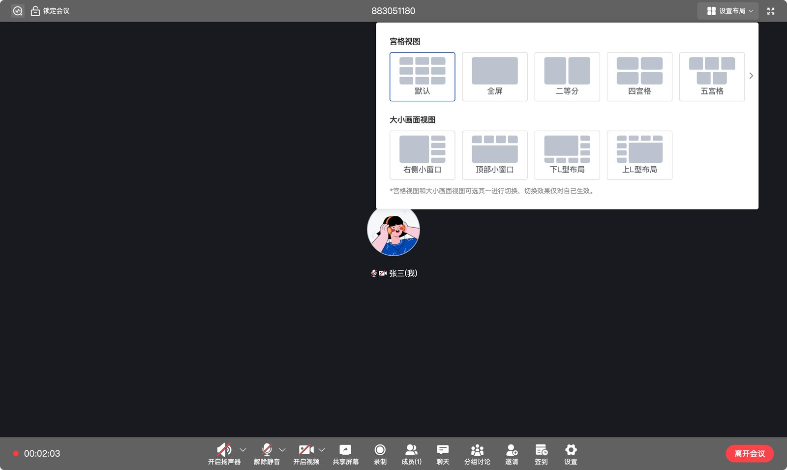

此外还有**分组讨论**（按组数拆分讨论组）、**签到**（设定时长发起签到，查看签到记录）、**云端录制**等。

### 会后

历史会议里可以看到会议时间、会议号、类型、资料和与会人员，一键「重新开始」同样的会议。

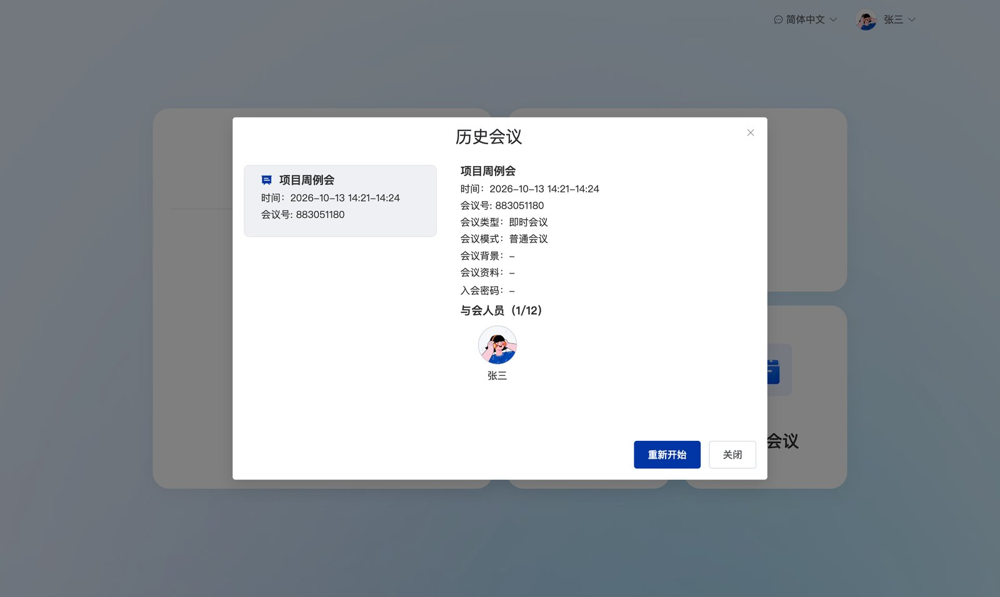

---

## RTC 演示

展示 SRTC 音视频 SDK 的底层能力，适合评估通话质量和各种实时场景。

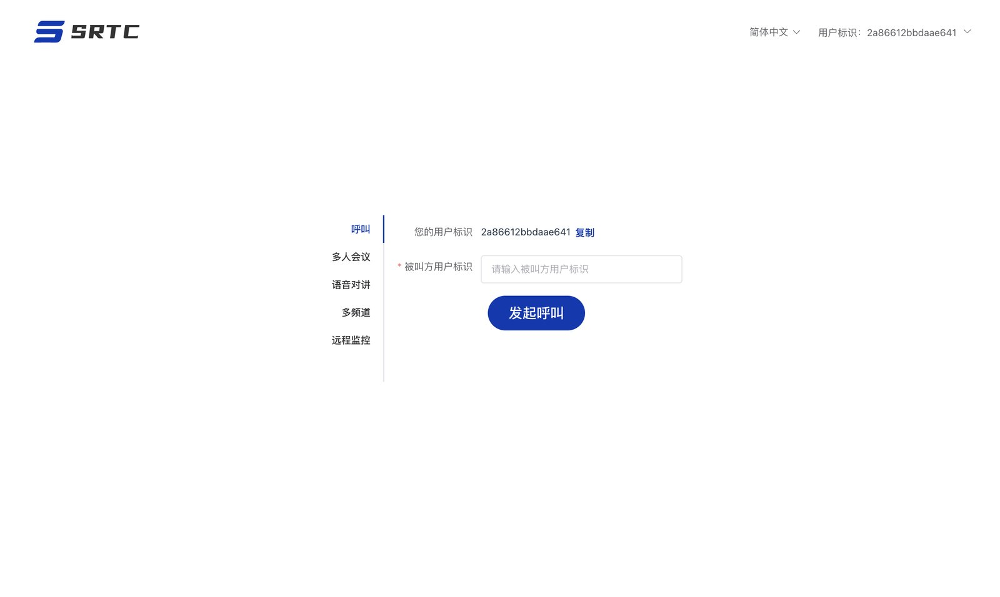

| 场景 | 体验内容 |
| --- | --- |
| **呼叫** | 输入对方的用户标识发起一对一音视频呼叫，接听、拒接、挂断 |
| **多人会议** | 多人音视频、屏幕共享、共享白板、聊天、语音转写（实时字幕）、云端录制、本地录制、网络质量、说话人提示、邀请成员与设备 |
| **语音对讲** | 按住说话的对讲、频道内文字消息、按段语音录制，适合调度场景 |
| **多频道** | 同时加入多个频道，分别收听、发言 |
| **远程监控** | 监管台 9 宫格同时查看多台终端画面，点选收听、按住喊话定向对讲；被监控的安卓终端无感入会推流 |

**呼叫**：输入对方的用户标识发起呼叫，对方接听后进入一对一通话。

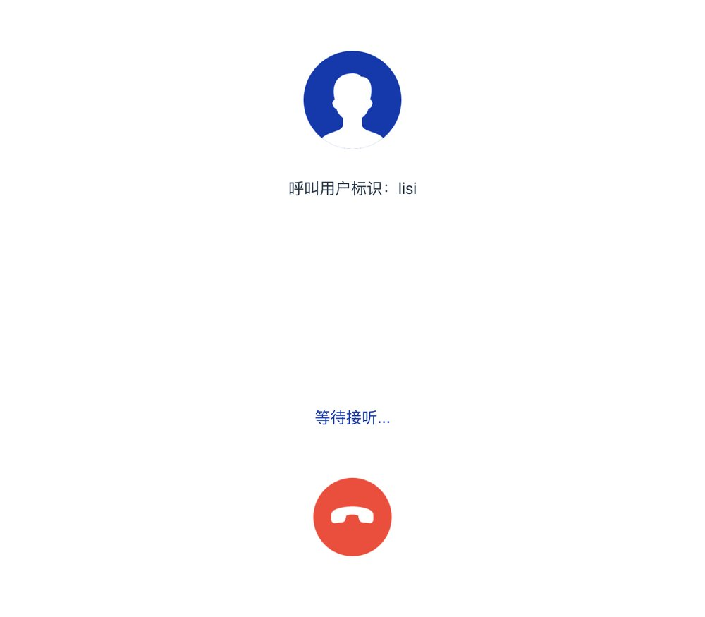

**多人会议**：顶部可以看到频道、网络质量评分（MOS），底部工具栏有扬声器、音频、视频、共享屏幕、共享白板、
云端录制、本地录制、邀请（成员或设备）、聊天、语音转写。

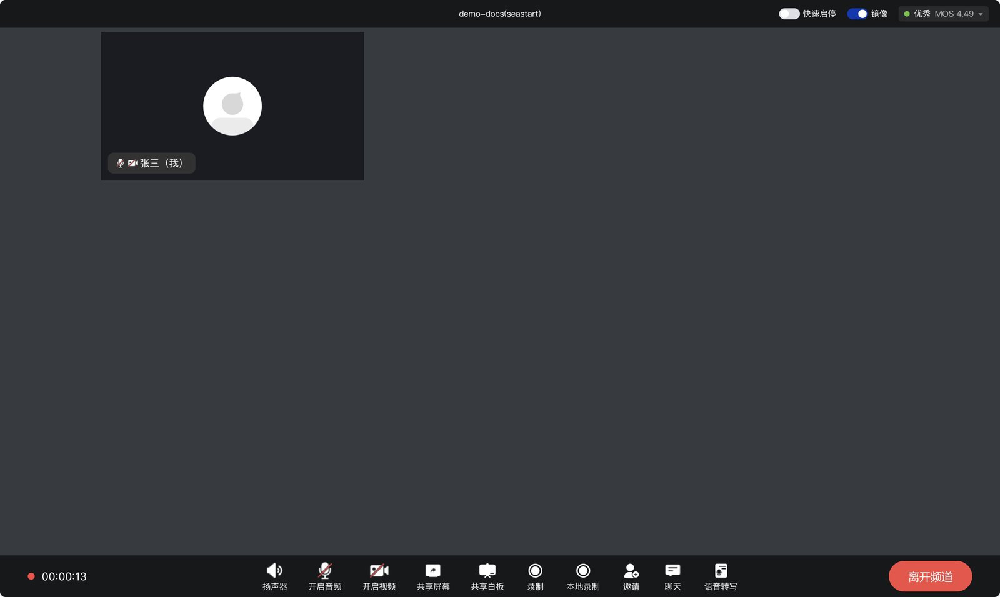

**语音对讲**：进入后自动加入频道、常开收听，按住按钮（或长按空格键）说话；右侧是频道内文字消息；
可以开启语音录制，一次讲话录成一段，录音在管理后台查看。

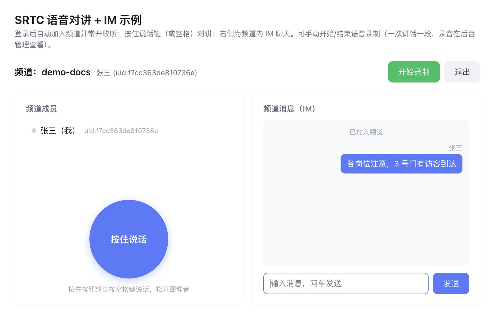

**远程监控监管台**：

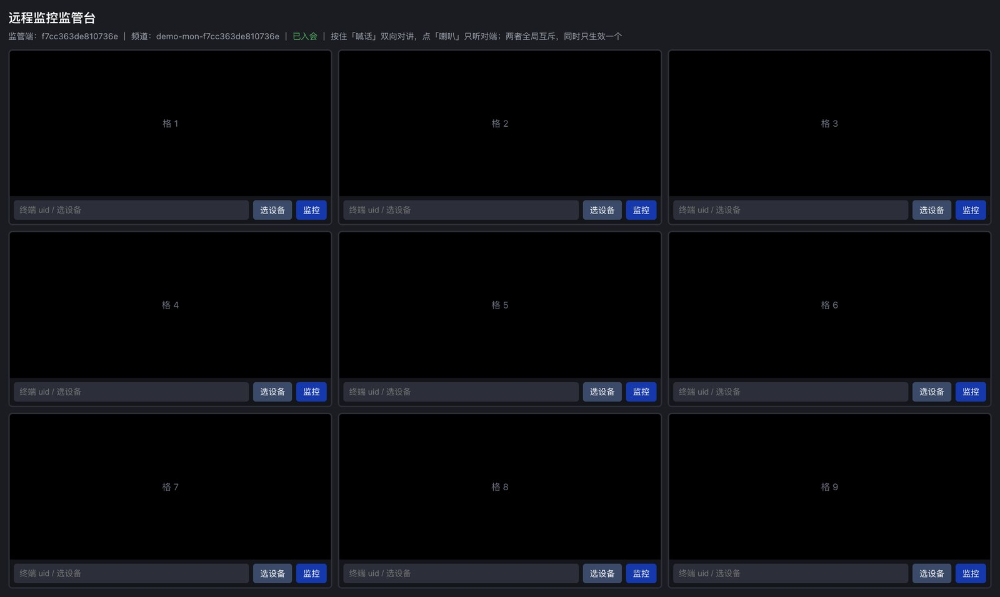

---

## 体验建议

+ 用**两台设备**（或两个浏览器）加入同一个会议 / 频道，才能看到互通效果
+ 浏览器推荐 Chrome、Edge 最新版，首次使用需允许摄像头和麦克风权限
+ 想体验**会议室终端、监控摄像头接入**，请联系我们安排设备联调演示
