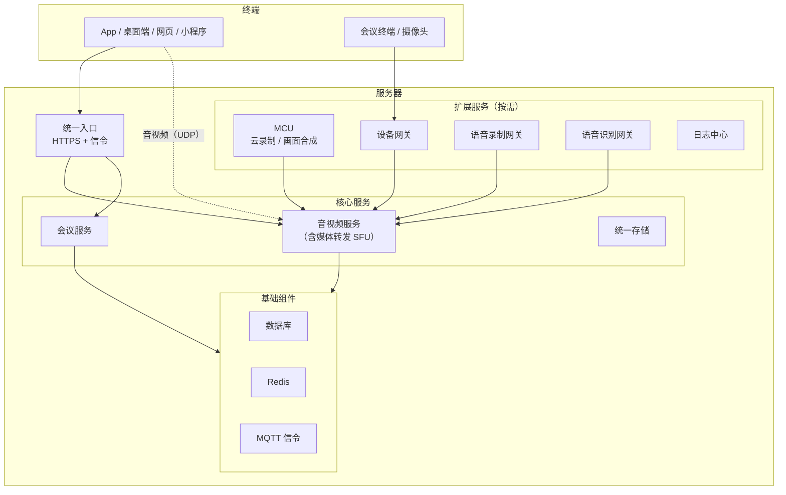

我们的平台可以完整部署在客户自己的服务器上，**全程离线安装**，不依赖外网。本页说明一套环境由哪些部分组成，
帮你准备服务器、和客户的网络、安全部门对齐方案。端口放通见[网络与端口要求](/zh/product/deploy/ports)。

---

## 整体架构

---

## 服务清单

### 必装

| 服务 | 作用 |
| --- | --- |
| 统一入口（Nginx） | 对外的 HTTPS 入口，承载接口、管理后台、网页客户端和信令 |
| 音视频服务 | 频道、成员、权限、媒体转发（SFU）。管理后台也在这里 |
| 统一存储 | 录像、录音、会议附件的存储网关，可对接本地磁盘或对象存储 |
| 数据库 | PostgreSQL；也支持**复用客户已有的人大金仓、达梦** |
| Redis | 缓存与状态 |
| MQTT 信令 | 会控消息、成员状态等实时信令 |

### 按需

| 服务 | 什么时候装 |
| --- | --- |
| 会议服务 | 使用 SMeeting 会议能力时（只用 SRTC 音视频能力可以不装） |
| MCU | 需要**云端录制**、**画面合成**、**转推直播**，或接入的 **SIP / H.323 终端要看到会里画面**时 |
| 设备网关 | 需要接入 SIP / H.323 终端、国标摄像头、RTSP 视频流时，见[设备接入](/zh/product/device-access/overview) |
| 语音录制网关 | 需要按人分段录音（对讲、调度留痕）时 |
| 语音识别网关 | 需要实时字幕、会议纪要时；识别引擎需另行部署 |
| 日志中心 | 需要集中查看客户端日志与通话质量数据时 |
| 监控中心 | 需要监控服务器与服务运行状态时 |

---

## 安装方式

+ 交付物是一个**离线安装包**（含全部服务镜像）和一个 **Web 安装器**
+ 在服务器上运行安装器，用浏览器打开安装页面，按 **基础组件 → 核心服务 → 扩展服务** 的顺序逐个安装，每个服务一张卡片、填好参数即可
+ 安装器同时负责后续的**升级**：导入新版本镜像后在页面上一键升级，配置自动合并
+ 安装完成后导入**授权文件**，平台才能正常入会

<Note>
安装器装完即可关闭，它有修改配置、重启服务的权限，**不要对外开放**。
</Note>

---

## 环境要求

| 项目 | 要求 |
| --- | --- |
| CPU 架构 | x86_64（amd64）、ARM64（鲲鹏、飞腾等）均支持 |
| 操作系统 | 主流 64 位 Linux 发行版，含信创操作系统；具体版本请与我们确认 |
| 运行环境 | Docker（安装器可一键安装，无需联网） |
| 数据库 | PostgreSQL（随包安装）、人大金仓、达梦 |
| 证书 | 对外域名的 HTTPS 证书（含完整证书链）；纯内网没有正式证书时可用自签证书，但各终端需要信任对应的根证书 |

服务器配置与并发规模、是否录制、设备数量强相关，请联系我们按实际场景评估。

---

## 部署形态

| 形态 | 说明 | 适合 |
| --- | --- | --- |
| **单机** | 所有服务装在一台服务器 | 测试、中小规模 |
| **分机** | MCU、设备网关等扩展服务单独部署到其他服务器 | 录制、设备接入量大，需要隔离资源 |
| **多媒体节点** | 多台服务器各跑一个媒体转发节点，按负载或就近分配用户 | 大并发、多地域，见[多节点与就近接入](/zh/product/deploy/multi-node) |
| **内外网双平面** | 同一套平台同时服务内网和外网用户 | 政企内网 + 外网移动办公，见[内外网与多线路](/zh/product/deploy/networks) |
| **光闸跨网** | 平台在内网，外网用户经光闸接入 | 公检法、政务等强隔离网络，见[光闸跨网接入](/zh/product/deploy/optical-gap) |
