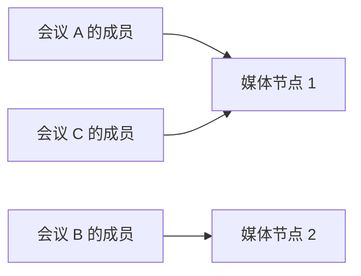
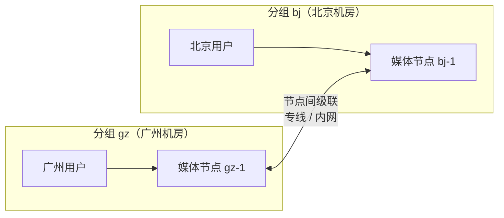

音视频媒体由**媒体节点**（SFU）负责转发。一台服务器的转发能力有上限，并发规模大、
或者用户分布在多个机房/地区时，可以部署多个媒体节点，由平台自动给用户分配节点。
端口要求见[网络与端口要求](/zh/product/deploy/ports)，组件构成见[组件与架构](/zh/product/deploy/architecture)。

---

## 三种分配方式

| 方式 | 效果 | 适合 | 默认 |
| --- | --- | --- | --- |
| **按负载分配** | 每个频道整体落在一个节点上，新频道分给负载较低的节点 | 大量中小规模的会议、对讲 | 开启 |
| **满载溢出** | 频道所在节点满了，后进来的人分到其它节点，同一场会议跨节点互通 | 单场会议人数可能超过一台服务器的承载 | 关闭，按需开启 |
| **就近接入** | 节点按机房/地区分组，用户进入自己所在分组的节点，同一场会议的各地用户跨节点互通 | 多地区、多园区，各自有本地机房 | 关闭，按需开启 |

后两种都会出现**同一个频道分布在多个节点上**，节点之间自动级联转发（只转发有人订阅的流），
对用户和业务系统透明：客户端和业务接口都不需要改动，进的还是同一个频道。

### 按负载分配（默认）

+ 一个频道的第一个人进来时，平台在可用节点中选负载较低的一个，之后同频道的人都进这个节点
+ 负载按节点实际的转发量（包速率）、出口带宽和 CPU 综合评估；CPU 超过熔断阈值（默认 90%）的节点不再接新频道
+ 节点满载后，新频道分到其它节点；**已在该节点上的频道再进人会被拒绝**，客户端收到错误码 `1035`（流媒体节点已满载）

这种方式下**单场会议的规模受单台节点承载上限限制**，扩容是增加能同时开的会议数量。

### 满载溢出

在默认方式的基础上，频道所在节点满了之后不再拒绝，而是把后面的人分到其它有余量的节点：

### 就近接入

把媒体节点按机房/地区分成若干**服务器分组**，业务系统在为用户获取加入频道 token 时带上
这个用户所属的分组（[获取加入频道 token](/zh/rtc/server-api/channel#获取加入频道token) 的 `sg` 参数），
平台就把他分到本组的节点：

+ 同一场会议里，广州用户的流只在广州节点上收发，跨地区只走一份节点间级联，节省跨地区带宽
+ 分组内有多个节点时，组内再按负载分配；组内节点都满时是否溢出到组内其它节点，取决于是否同时开启「满载溢出」
+ 用户所属分组**暂时没有可用节点**时，平台会把他分到其它分组的节点，保证能进会
+ 用户属于哪个分组由业务系统决定（例如按用户所在单位、园区），平台不按 IP 自动判断

<Note>
分组和[内外网线路](/zh/product/deploy/networks)是两回事：分组决定用户**进哪台节点**，线路决定用户**用哪个地址连这台节点**。
同一个分组的节点同样可以有内网、外网两条线路。
</Note>

---

## 容量与调度配置

在管理后台 **运维管理 → 媒体节点** 页点「调度配置」编辑，保存后 30 秒内生效，不需要重启服务。
同页的节点列表会显示每个节点实际生效的承载上限，可以据此确认配置是否生效。

| 配置项 | 说明 |
| --- | --- |
| `channel_overflow` | 开启「满载溢出」 |
| `sg_affinity` | 开启「就近接入」 |
| `cpu_fuse_pct` | CPU 熔断百分比，超过后不再分配新频道，默认 90 |
| `pps_per_core` | 每核满载包速率，节点包速率上限 = 该值 × 核数，默认 20000 |
| `max_tracks` | 节点最多承载多少路流，按节点分别配置，0 = 不限制 |
| `max_bandwidth_mbps` | 节点出口带宽上限（Mbps），按节点分别配置，0 = 不限制。一路 720p 约 1.1 Mbps |

容量可以按节点单独配置，配置不同的服务器混合部署时各自填写即可。

<Warning>
同一个频道跨节点后，**从其它节点级联进来的流也占本节点的路数**。所以开启溢出或就近接入后，
路数这一维不是加一台就翻倍；规划容量时以带宽和 CPU 为主，`max_tracks` 只作兜底。
</Warning>

---

## 部署前提

+ **所有媒体节点共用同一套数据库、Redis**，由同一个管理后台统一管理
+ **节点之间 39002/UDP 双向互通**，且丢包很低（同机房内网或专线）。开启溢出、就近接入前务必先确认，否则跨节点的用户之间会没有声音画面
+ **各节点的网络线路配置保持一致**：线路名称相同，每个节点各自填自己的媒体地址
+ **多个节点共用同一个公网 IP 时，每个节点用不同的媒体端口**（例如 39001、39011），防火墙按端口分别映射到对应节点，**端口号保持不变**
+ **MCU、设备网关、语音录制、语音识别网关要能访问每个媒体节点的媒体端口**：它们以成员身份进会，频道落在哪个节点就连哪个节点，这是最容易漏放通的一条
+ **各服务器时钟同步（NTP）**：时钟偏差会让通话质量指标失真，私有化内网要单独准备时间源

---

## 节点故障时

+ 节点停止上报心跳后，平台不再往它分配新用户，后续进会和重连会分到其它在线节点
+ 故障节点上的用户会断开并由客户端自动重连到其它节点；如果其它节点也满载，客户端会持续重试直到有空余容量
+ 建议按「坏一台，剩下的仍能扛住全部负载」预留容量

---

## 限制

+ 节点之间的级联按内网/专线设计，**不支持节点之间跨公网级联**
+ 就近接入的分组由业务系统指定，平台不做按 IP 的地理位置判断
+ 单场超大规模的「少数人发言、大量人观看」场景，更适合用 MCU 转推直播分发给观众，具体请联系我们评估
