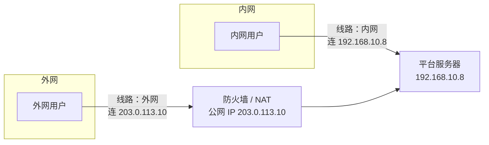

政企客户常见的情况：平台部署在内网机房，内网员工直接访问；出差、居家的同事从外网访问，
走的是防火墙映射出去的公网地址。同一套平台、同一场会议，内外网用户要能互通。

我们用**网络线路**解决这个问题：平台为每条线路分别配置一组「客户端该连的地址」，
用户进会时说明自己走哪条线路，平台就把对应的地址发给他。

---

## 网络线路是什么

每条线路包含两类地址：

| 地址 | 作用 | 端口 |
| --- | --- | --- |
| 入口地址 | 接口、信令、网页访问 | 443/TCP、18883/TCP |
| 媒体地址 | 音视频 | 39001/UDP |

常见是两条线路：**内网**、**外网**。也可以按需配置更多（例如专网、另一个园区）。

---

## 部署时要准备什么

1. **每条线路的地址**：内网线路用服务器内网地址；外网线路用防火墙映射出去的公网 IP 或域名
2. **防火墙映射**：外网线路的 443/TCP、18883/TCP、39001/UDP 映射到平台服务器，**端口号保持一致**
3. **域名与证书**：内外网通常使用不同的访问地址，证书要覆盖到用户实际访问的那个域名
4. **在安装器中选择网络模式**：仅内网、仅外网、或内外网都有。安装完成后，各线路的入口地址可以在管理后台 **系统配置 → 网络** 中查看和修改

<Warning>
**入口 IP 和出口 IP 不同的机房要特别注意**：很多机房用户访问进来的公网 IP，和服务器访问外网时出去的 IP 不是同一个。
这种情况下必须把外网线路的媒体地址**明确配置成用户访问进来的那个公网 IP**，否则外网用户能进会但没有画面和声音。
</Warning>

---

## 用户怎么走对线路

平台根据用户进会时带的「线路」决定发哪组地址给他。业务系统有两种做法：

+ **让用户选**：客户端列出「内网 / 外网」，用户自己选
+ **服务端自动判断**：按用户访问的域名、或用户的 IP 是否是内网地址来判断

没有指定线路时默认按**内网**处理。具体做法和代码示例见开发者文档[多网络线路](/zh/rtc/network-line)。

<Tip>
现象「内网用户正常、外网用户能进会但没画面」，十有八九是外网用户被当成了内网线路，或者外网线路的媒体地址配错。
</Tip>

---

## 与光闸的关系

内外网之间是**光闸 / 网闸**隔离、不能直接做防火墙映射时，外网线路的地址要指向光闸外侧的穿透网关，
见[光闸跨网接入](/zh/product/deploy/optical-gap)。
