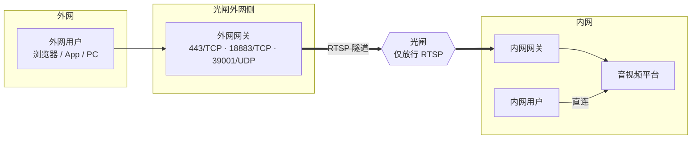
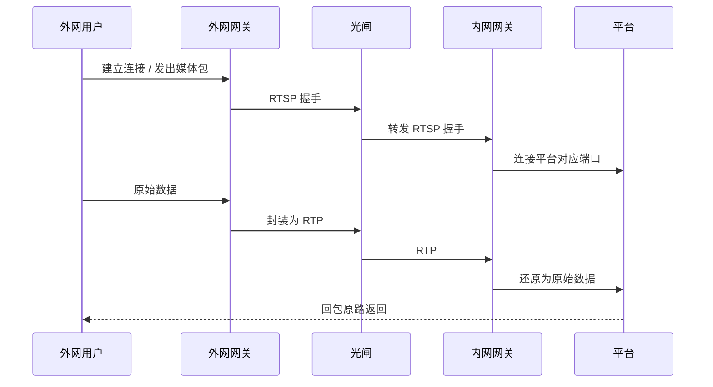

公检法、政务等单位的内网和外网之间用**光闸（网闸）**做物理隔离。光闸只放行特定的业务协议，
不允许普通的 TCP / UDP 直接穿过，所以音视频平台的接口、信令和媒体流都过不去。

现场光闸通常已经开放了 **RTSP 视频业务**通道。我们的方案利用这一点：在光闸两侧各放一台**穿透网关**，
把平台的流量封装成标准 RTSP 会话穿过光闸，到对面再还原。外网用户和内网用户就能在同一场会议里互通。

---

## 部署架构

| 组件 | 位置 | 作用 |
| --- | --- | --- |
| 外网网关 | 光闸外网侧 | 给外网用户提供接入端口，把流量封装成 RTSP 会话送进光闸 |
| 内网网关 | 光闸内网侧 | 把光闸转进来的 RTSP 会话还原成原始流量，交给平台 |
| 音视频平台 | 内网 | 正常部署；内网用户直接访问 |

---

## 工作原理

+ **接口和信令（TCP）**：外网用户每建一条连接，外网网关就建一条 RTSP 会话，用 RTSP over TCP 传输，保证可靠有序
+ **音视频（UDP）**：外网网关收到某个用户的第一个媒体包时建一条 RTSP 会话，用 RTP over UDP 传输，保证实时性
+ 会话建立后双向传输，平台的回包原路返回

---

## 方案特点

| 特点 | 说明 |
| --- | --- |
| 符合光闸管控 | 穿过光闸的只有标准 RTSP / RTP，光闸按 RTSP 业务放行即可，不需要开放通用转发 |
| 端到端加密 | 网关不解密数据，HTTPS、加密信令、加密媒体原样透传，证书只在内网平台上 |
| 对业务透明 | 平台和客户端都不用为光闸改造，网页、Android、iOS、PC 都能接入 |
| 通道少 | 所有用户的媒体共用一个端口，外网接入只需要 **3 条通道**（接口、信令、媒体各一条），不随人数增加 |
| 不需要额外中转 | 不需要另外部署 TURN 中转或媒体转换服务 |
| 内外网同会 | 外网用户和内网用户在同一场会议里音视频互通 |
| 会话隔离 | 每个外网连接对应独立的 RTSP 会话，空闲自动回收，可按端口限制并发 |

---

## 部署条件

| 项目 | 要求 |
| --- | --- |
| 服务器 | 光闸外网侧、内网侧各一台，分别部署外网网关、内网网关 |
| 外网地址 | 外网网关要有外网用户能访问的 IP 或域名 |
| 光闸策略 | 放行两侧网关之间的 RTSP 控制端口（如 3 个 TCP 端口）和 RTP 媒体端口段（UDP，每个外网媒体连接占一对，按外网并发人数规划）。具体端口在实施时与光闸厂商共同确定 |
| 外网侧端口 | 外网网关对外开放 443/TCP、18883/TCP、39001/UDP，与平台端口保持一致 |
| 内网侧连通 | 内网网关能访问平台的 443/TCP、18883/TCP、39001/UDP |
| 平台配置 | 平台按[内外网双线路](/zh/product/deploy/networks)部署，**外网线路的地址指向外网网关** |
| 授权 | 穿透网关需要单独的授权 |
| 容量 | 按外网并发参会人数规划网关的并发会话数和光闸吞吐 |

---

## 使用须知

<Warning>
**外网用户必须明确走「外网」线路**。经过网关后，平台看到的来源地址是网关而不是用户本身，
无法靠 IP 自动判断内外网。业务系统要让外网入口的用户固定使用外网线路（例如按访问域名区分），否则会进会后没有画面。
</Warning>

+ **内容审计**：数据全程加密透传，光闸只能看到 RTSP / RTP 封装，看不到业务内容。如果客户要求光闸做内容审计，需要提前沟通
+ **来源 IP**：平台日志里外网用户的来源地址显示为网关地址
+ **容量评估**：外网用户每人大约占用 2 条媒体会话、3~4 条接口连接，大规模接入前建议先做压力测试
+ **实施方式**：光闸穿透按项目实施，需要我们和客户、光闸厂商三方对齐端口与策略，请联系我们
