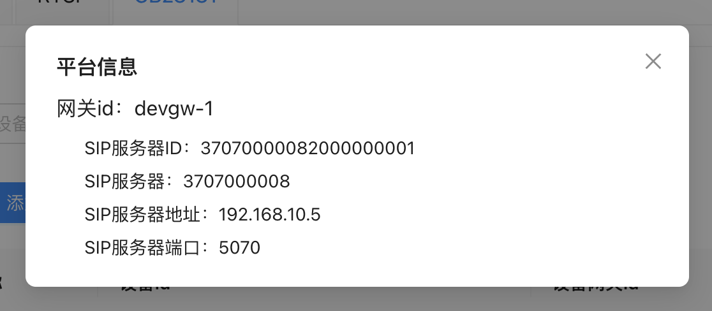
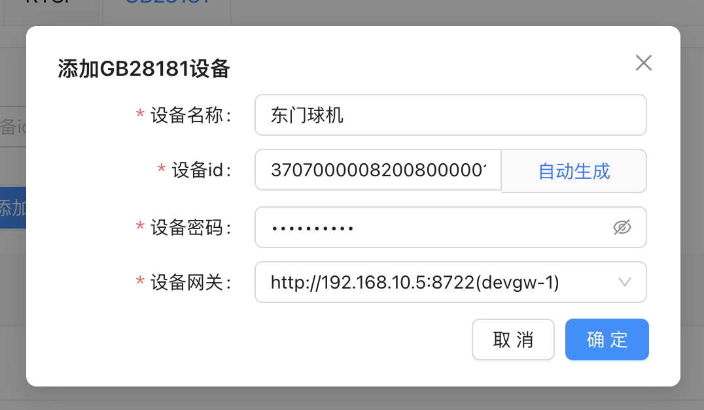
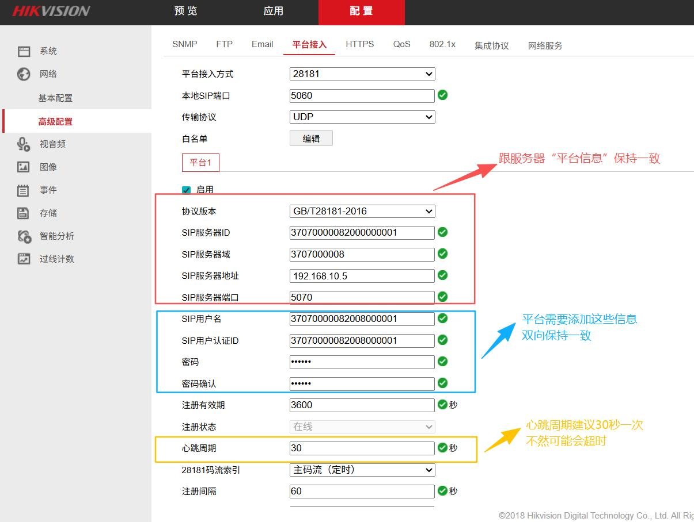
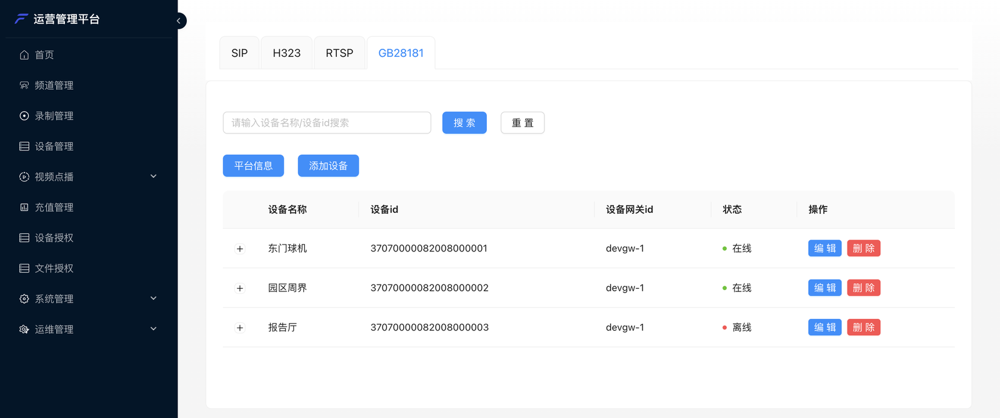
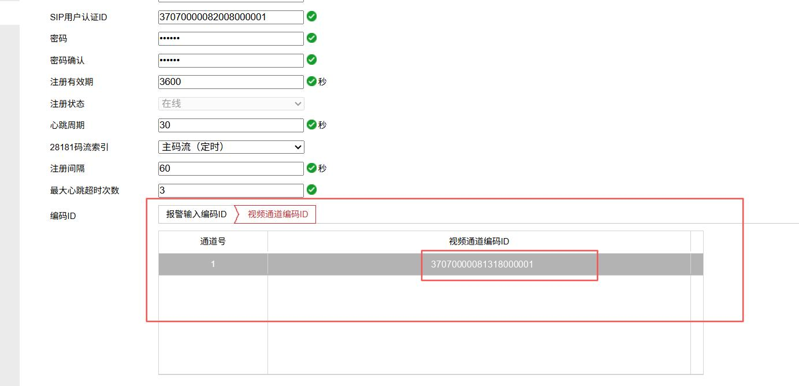
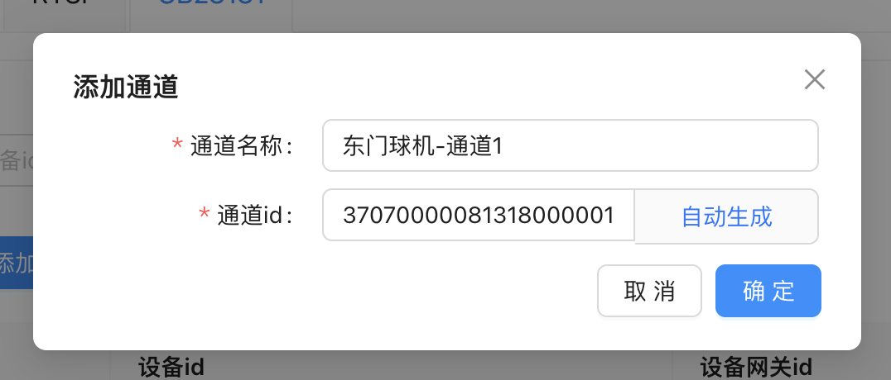
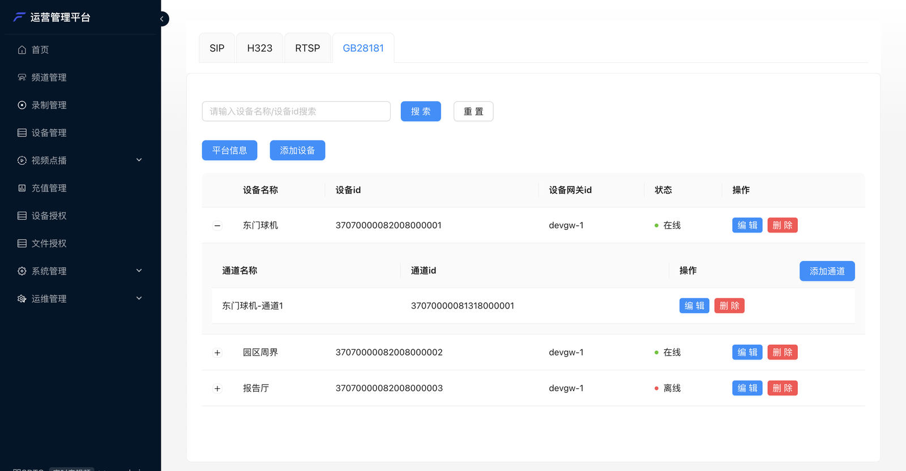

国标摄像头接入分三步：**摄像头注册到设备网关 → 在后台登记设备和通道 → 把通道邀请进会**。
摄像头只往会里送画面（单向），一台 NVR 下的多个通道可以各自作为一路画面进会。

下面以海康摄像头为例。所有示例值前后对应，照着替换成你自己的即可。

---

## 1. 查看平台信息

打开管理后台 **设备管理** → **GB28181** → **平台信息**：



这四项要原样填到摄像头上，记下来：

| 平台信息 | 示例 | 含义 |
| --- | --- | --- |
| SIP 服务器 ID | `37070000082000000001` | 设备网关的国标编号 |
| SIP 服务器（域） | `3707000008` | 国标域 |
| SIP 服务器地址 | `192.168.10.5` | 设备网关地址，摄像头要能访问到 |
| SIP 服务器端口 | `5070` | 国标信令端口 |

有多个设备网关时，每个网关各列一组，摄像头注册到哪个网关就用哪组。

---

## 2. 在后台登记设备

**GB28181** 标签下点 **添加设备**：



| 字段 | 填什么 |
| --- | --- |
| 设备名称 | 自己起，比如「东门球机」 |
| 设备 id | 摄像头的国标编号（20 位数字）。没有现成的可以点 **自动生成**，再把生成的编号填到摄像头上 |
| 设备密码 | 摄像头注册时用的密码，两边要一致 |
| 设备网关 | 摄像头注册到哪个网关 |

---

## 3. 在摄像头上配置平台接入

登录摄像头的 Web 管理页面，海康在 **配置 → 网络 → 高级配置 → 平台接入**。平台接入方式选 **28181**，启用后填：



| 摄像头上的字段 | 填什么 | 对应 |
| --- | --- | --- |
| 协议版本 | GB/T28181-2016 | — |
| SIP 服务器 ID | `37070000082000000001` | 第 1 步「平台信息」 |
| SIP 服务器域 | `3707000008` | 第 1 步「平台信息」 |
| SIP 服务器地址 | `192.168.10.5` | 第 1 步「平台信息」 |
| SIP 服务器端口 | `5070` | 第 1 步「平台信息」 |
| SIP 用户名、SIP 用户认证 ID | `37070000082008000001` | 第 2 步的「设备 id」 |
| 密码 | 与第 2 步的「设备密码」一致 | 第 2 步 |
| 心跳周期 | **30 秒** | 太长会被判定掉线 |

保存后，摄像头上的 **注册状态** 变成「在线」，后台设备列表里的状态也会变成 **在线**：



<Warning>
**心跳周期建议 30 秒**。设备默认值往往更长，平台等不到心跳会把设备判为离线，邀请时就会失败。
</Warning>

---

## 4. 登记通道

一台设备下可以有多个视频通道（NVR 的每路摄像头、球机的每个码流），**进会的单位是通道**。

先在摄像头上找到通道编码：同一页往下的 **编码 ID → 视频通道编码 ID**，记下通道的编码：



回到后台，点设备左侧的 **+** 展开，点 **添加通道**：



| 字段 | 填什么 |
| --- | --- |
| 通道名称 | 会中显示的名字，比如「东门球机-通道1」 |
| 通道 id | 摄像头上的「视频通道编码 ID」 |

添加后的效果：



---

## 5. 邀请进会

国标摄像头不能自己呼入，只能由平台邀请：

+ **管理后台**：会议详情 → **邀请** → **邀请设备** → **国标GB28181**
+ **会议客户端**：主持人 **邀请** → **邀请设备**
+ **业务系统**：调用[邀请设备入会](/zh/rtc/server-api/agent#邀请设备入会)，每个通道是一条邀请

进会后，这路画面就是会里的一名成员，名字是通道名称。

### 云台与预置位

转动镜头、变焦、调用预置位目前**通过服务端接口操作**（管理后台暂未提供按钮）：
[控制国标设备的云台](/zh/rtc/server-api/agent#控制国标设备的云台（方向与变焦）)、[操作国标设备的预置位](/zh/rtc/server-api/agent#操作国标设备的预置位)。

---

## 字段对照速查

```text
摄像头                       管理后台
─────────────────────────   ─────────────────────────
SIP 服务器 ID / 域 / 地址 / 端口  ←  平台信息
SIP 用户名 / 认证 ID          =   设备 id
密码                         =   设备密码
视频通道编码 ID               =   通道 id
```

接不上？见[常见问题](/zh/product/device-access/faq#国标摄像头接不上)。
