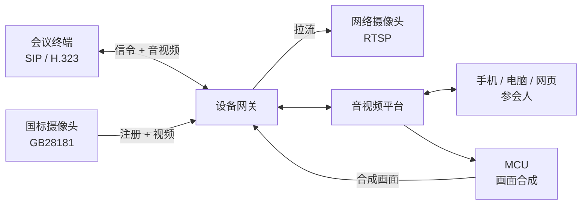

会议室里已经有的硬件——华为、科达等品牌的视频会议终端，墙上的监控摄像头，NVR 里的一路视频流——
不用换设备、不用装 App，就能和手机、电脑上的参会人开同一场会。这项能力我们叫**会议室连接器**，
背后的服务叫**设备网关**。

---

## 能接什么

| 设备 | 协议 | 典型场景 | 会中能做什么 |
| --- | --- | --- | --- |
| **视频会议终端** | SIP、H.323 | 会议室硬终端、指挥中心大屏、话机 | **双向**：终端的画面和声音进会，会里的画面和声音回到终端 |
| **国标监控摄像头 / NVR** | GB28181 | 公安、应急、园区监控接入会商 | **单向**：摄像头画面进会，可遥控云台 |
| **网络摄像头 / 视频流** | RTSP | 任意能出 RTSP 地址的摄像头、编码器、流媒体服务器 | **单向**：视频流进会 |

设备进会后，在会里就是一名普通成员：名字是你登记时填的「显示名称」，和其他人一样出现在成员列表、
画面布局和录制里。

---

## 工作原理

+ 设备只和**设备网关**打交道，网关负责协议转换（SIP / H.323 / GB28181 / RTSP ↔ WebRTC），
  再以普通成员的身份进会
+ 会议终端看到的是 **MCU 合成的整场画面**（按会议布局排好的多宫格），听到的是**整场混音**。
  所以要让终端看到画面，平台必须部署 MCU（云录制网关）——终端入会时平台会自动为该会议启动合成，不用手动开
+ 摄像头和视频流只往会里送画面，不接收会里的音视频

---

## 各协议能力

| | SIP 终端 | H.323 终端 | GB28181 | RTSP |
| --- | --- | --- | --- | --- |
| 设备主动呼入会议 | ✅ | ✅ | — | — |
| 平台邀请设备入会 | ✅ | ✅ | ✅ | ✅ |
| 设备注册到平台 | ✅ 可选 | ✅ 可选（网关内置网守） | ✅ 必须 | — |
| 画面进会 | ✅ | ✅ | ✅ | ✅ |
| 声音进会 | ✅ | ✅ | ✅（设备带音频时） | ✅（流里带音频时） |
| 接收会里的画面和声音 | ✅ | ✅ | — | — |
| 视频编码 | H.264 | H.264 | H.264（PS 封装） | H.264；H.265 自动转成 H.264 |
| 音频编码 | G.711A | G.711A | G.711A | 常见编码均可，网关会转码 |
| 云台 / 预置位 | — | — | ✅（通过服务端接口） | — |

<Note>
暂不支持终端的**双流（辅流）内容共享**：终端用辅流共享的电脑画面不会进会。要共享内容，请在会议客户端里共享屏幕。
</Note>

---

## 三种入会方式

**1. 设备主动呼入**——在终端上像打电话一样拨会议号：

+ 终端已注册到平台：直接拨**会议号**
+ 终端没注册：拨 **`会议号@设备网关IP`**，例如 `30332718@192.168.10.5`

**2. 平台邀请设备入会**——平台主动呼叫设备，终端会像来电一样响铃（可设置自动应答）：

+ 在**管理后台**的会议详情里点「邀请 → 邀请设备」
+ 在**会议客户端**里，主持人点「邀请 → 邀请设备」
+ 业务系统调用**服务端接口**邀请，见[设备接入指南](/zh/rtc/server-api/guides/agents)

**3. 注册还是 IP 直连？** 这决定了平台怎么找到设备：

| | 终端注册 | IP 直连 |
| --- | --- | --- |
| 做法 | 在后台建一个账号，终端用这个账号注册到设备网关 | 在后台登记终端的 IP 和端口 |
| 平台能看到在线状态 | ✅ | ❌ |
| 设备呼入 | 只拨会议号 | 要拨 `会议号@网关IP` |
| 网络要求 | **设备能访问到网关**即可，适合设备在 NAT 后面 | **网关要能访问到设备的 IP** |
| 推荐 | ✅ 优先用 | 设备不支持注册、或固定 IP 的场景 |

国标摄像头只有注册一种方式，RTSP 流只有平台拉流一种方式。

---

## 部署前提

| 项目 | 说明 |
| --- | --- |
| **设备网关** | 私有化部署时按需安装，可装多台。设备登记时要选择它挂在哪个网关下 |
| **MCU** | SIP / H.323 终端要看到会里的画面，需要部署 MCU。只接摄像头、视频流可以不装 |
| **授权** | 设备网关需要单独的授权文件；**每台入会的设备同时占用一个用户并发和一个设备并发**名额 |
| **网络** | 设备与设备网关之间要放通 SIP / H.323 / GB28181 信令端口和 RTP 端口段，见[网络与端口要求](/zh/product/deploy/ports) |
| **设备呼入落到哪个应用** | 每个设备网关的呼入固定进一个应用，部署时配置 |

<Tip>
「会议号」指 SMeeting 会议的会议号。只用 SRTC 音视频层、没有会议层时，设备呼入拨的是**频道名**，
所以频道名最好用终端能输入的纯数字。
</Tip>

---

## 下一步

| 我要接 | 看这篇 |
| --- | --- |
| 会议室视频终端 | [SIP / H.323 终端](/zh/product/device-access/sip-h323) |
| 国标监控摄像头 | [GB28181 摄像头](/zh/product/device-access/gb28181) |
| 网络摄像头、视频流 | [RTSP 视频流](/zh/product/device-access/rtsp) |
| 接不通、没画面 | [常见问题](/zh/product/device-access/faq) |
| 用业务系统调接口接设备 | [设备接入指南](/zh/rtc/server-api/guides/agents) |
