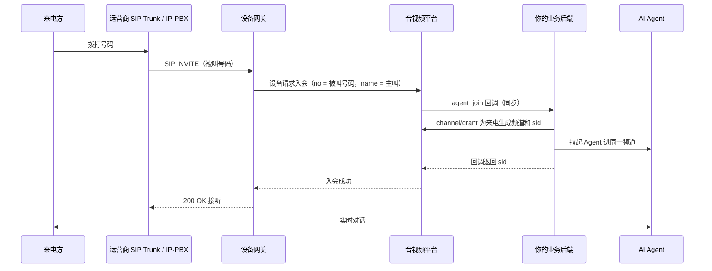

电话线路对设备网关来说就是一路 **SIP**，和接 SIP 会议终端走的是同一套能力：来电在频道里是一名普通成员，
可以和 [SAI Agent](/zh/rtc/python/advanced/pipecat) 对话，也可以进 SMeeting 会议。**不需要专门的电话硬件**——
运营商的 SIP Trunk 或客户已有的 IP-PBX 都能直接对接。

| 能力 | 说明 |
| --- | --- |
| 呼入 | 来电经网关进频道，进哪个频道由你的业务后端决定（可以每通电话一个独立频道） |
| 呼出 | 服务端接口[邀请设备入会](/zh/rtc/server-api/guides/agents#邀请与会中操作)，网关向号码发起呼叫 |
| 按被叫号码分流 | 网关按被叫号码前缀把来电分到不同应用，例如 AI 号码进 AI 应用、其余进会议应用 |
| 电话按键 | 支持 RFC 4733（telephone-event）和 SIP INFO，按键以频道自定义消息送到 Agent |
| 音频编码 | **只支持 G.711 A-law（PCMA）**，线路侧需要选 PCMA |
| 主叫信息 | 主叫标识作为设备名称（`name`）带给业务后端 |

<Note>
按被叫号码分流、电话按键转发、平台拒绝时立即拒接来电，需要**设备网关 1.3.5 及以上**。
</Note>

---

## 工作原理



关键在 `agent_join` 回调：网关只把被叫号码（`no`）和主叫（`name`）交给平台，**进哪个频道、要不要接，由你的业务后端决定**。

---

## 三种接法

| 接法 | 做法 | 适合 |
| --- | --- | --- |
| **SIP Trunk 指向网关** | 在运营商后台把号码的呼入地址填成网关的公网地址和 SIP 端口（IP 对接） | 有固定公网 IP，号码直接买自运营商 |
| **网关注册到上游** | 网关以一个 SIP 账号注册到运营商或 PBX（见下文 `Reg`），来电由上游转给网关 | 运营商要求注册鉴权，或网关在 NAT 后面 |
| **经已有 IP-PBX 转接** | PBX 把某些分机 / 号码转给网关，其余照旧 | 客户已有呼叫中心，想把部分号码交给 AI |

会议电话入会（来电后输入会议号）需要 IVR 收号，由客户 PBX 完成后再转给网关；网关本身没有语音导航。AI 电话不需要收号，拨通即对话。

---

## 网关配置

配置在设备网关的 `options.xml`，改完重启网关生效。

### 监听与公网地址

```xml
<Sip enabled="true">
  <ListenPort>5060</ListenPort>
  <UseRtpAddress>true</UseRtpAddress>
</Sip>

<!-- 网关对外的公网地址，写进 SDP，线路侧往这里发语音 -->
<NatAddress>203.0.113.10</NatAddress>

<Rtp>
  <Port begin="58000" end="59000" />
</Rtp>
```

SIP 端口和 RTP 端口段要在防火墙放通，见[网络与端口要求](/zh/product/deploy/ports)。
`UseRtpAddress` 为 `true` 时，网关把语音回发到对端实际发来 RTP 的地址，对端在 NAT 后面也能听到声音。

### 来电进哪个应用

```xml
<Rtc>
  <!-- 默认应用：未命中下面路由的来电都进这里（例如 SMeeting 会议应用） -->
  <IncomingAppId>会议应用的 AppId</IncomingAppId>
  <!-- 按被叫号码前缀分流，最长前缀优先 -->
  <IncomingRoutes>
    <Route prefix="400" appid="AI 电话应用的 AppId" />
    <Route prefix="ai" appid="AI 电话应用的 AppId" />
  </IncomingRoutes>
</Rtc>
```

前缀匹配的是被叫号码。接运营商号码时，直接用号码本身（或号段）做前缀。

### 注册到运营商或 PBX（可选）

```xml
<Sip enabled="true">
  <Reg enabled="true">
    <Address>sip.example-carrier.com</Address>
    <Port>5060</Port>
    <Transport>udp</Transport>
    <Username>运营商分配的账号</Username>
    <Password>运营商分配的密码</Password>
  </Reg>
</Sip>
```

### 来电 IP 白名单（接公网线路时必开）

SIP 端口暴露在公网后会持续收到扫描呼叫。网关自带**自动黑名单**（同一 IP 30 秒内超过 5 次即封禁），
扫描不会进入入会流程；接运营商线路时对端 IP 是固定的，再打开白名单，只接受线路侧的来电：

```xml
<WhiteList enabled="true">
  <Ip>198.51.100.20</Ip>
  <Ip>198.51.100.0/24</Ip>
  <Ip>192.0.2.10-192.0.2.20</Ip>
</WhiteList>
```

支持单个 IP、IP 范围和 CIDR，仅 IPv4。

---

## 业务后端：每通电话一个频道

在 AI 电话应用上[设置回调](/zh/rtc/server-api/channel#设置回调)，订阅 `agent_join`。收到回调时：

1. 判断是不是电话：`type` 为 `2`（SIP），`no` 是被叫号码
2. 为这通电话生成一个唯一频道名，例如 `phone-` 加随机串
3. 用回调里的 `uid` 调[获取加入频道token](/zh/rtc/server-api/channel#获取加入频道token)，拿到设备的 `sid`
4. 异步拉起 Agent 加入同一频道，**不要等 Agent 入会再返回**
5. 回调返回 `{"code": 0, "data": "<sid>"}`；返回非 0 即拒接，网关回 603

<Warning>
`agent_join` 是同步回调，平台等待约 5 秒，超时视为失败。拉起 Agent、加载模型这类耗时操作放到回调返回之后。
</Warning>

字段说明和返回格式见[回调事件接入指南](/zh/rtc/server-api/guides/callbacks)。

**Agent 只听话机的声音**：部署了 MCU 时，平台会为 SIP 设备在频道里发布合成流（uid `__mcu__`），其中**包含 Agent 自己的声音**。
Agent 订阅全部音频时要按发送者过滤，只把设备 uid（`agent_join` 回调里的 `uid`）的音频送进语音识别，
否则 Agent 会听到自己说话、被自己打断。

---

## 电话按键

网关收到按键后，以**设备身份**向频道发一条自定义消息：

| 字段 | 值 |
| --- | --- |
| `action` | `dtmf` |
| `content` | `{"digit": "5", "duration": 160}`，`digit` 为 `0`–`9`、`*`、`#`、`A`–`D`，`duration` 单位毫秒 |
| 发送者 | 设备 uid |

Python SDK 里用 `on_custom_msg` 接收，例如交给 pipecat 管线处理：

```python
@transport.event_handler("on_custom_msg")
async def on_custom_msg(transport, msg):
    if msg.action != "dtmf" or msg.uid != device_uid:
        return
    digit = (msg.content or {}).get("digit")  # content 已按 JSON 解析成 dict
    # 例如按 0 转人工：把「用户按了 0」作为一句话交给 LLM，或直接走你的业务逻辑
```

---

## 挂断

- **来电方挂机**：设备离开频道，Agent 收到成员离开事件后结束会话
- **业务侧挂断**（例如 AI 说完告别语）：调[踢人](/zh/rtc/server-api/channel#踢人)接口把设备 uid 踢出频道，平台通知网关给线路发 BYE

---

## 常见问题

| 现象 | 原因与处理 |
| --- | --- |
| 呼叫一直不接通，线路侧最终超时 | 先看网关日志有没有收到 INVITE；没有则检查防火墙、白名单和线路侧的呼入地址 |
| 来电立即被拒（603） | 业务后端的 `agent_join` 返回了非 0，或频道名不合法、回调超时 |
| 接通后没有声音 | 线路侧编码不是 PCMA；或 RTP 端口段未放通、`NatAddress` 填错 |
| AI 说话总被打断 | 话机免提的回声或底噪被识别成用户插话。确认 Agent 只订阅设备 uid 的音频，并为电话场景提高插话门槛 |

接 SIP 会议终端的配置见 [SIP / H.323 终端](/zh/product/device-access/sip-h323)；AI 侧接入见[接入 pipecat](/zh/rtc/python/advanced/pipecat)。
