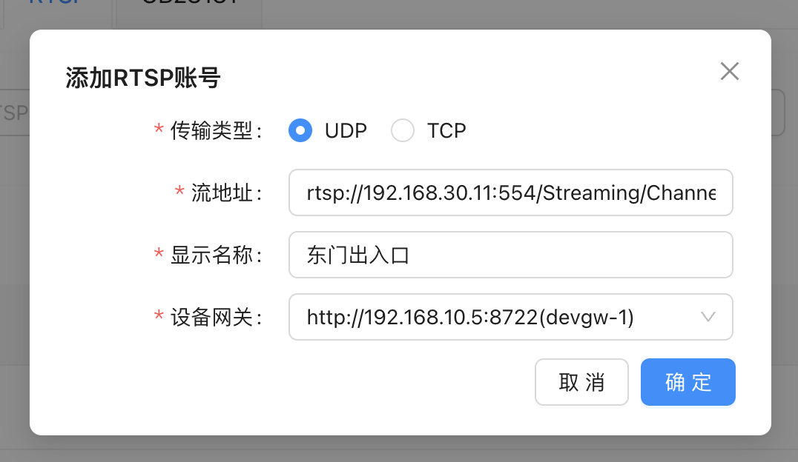
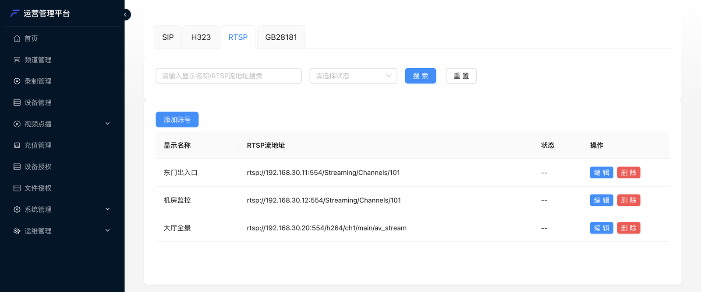

只要设备能给出一个 RTSP 地址（`rtsp://...`），就能把它的画面拉进会议。不需要设备支持国标，
也不需要设备注册——由设备网关主动去拉流。

---

## 1. 准备流地址

先在播放器（如 VLC）里打开流地址，**能播放再往下做**。常见格式：

| 品牌 | 主码流地址格式 |
| --- | --- |
| 海康 | `rtsp://用户名:密码@IP:554/Streaming/Channels/101` |
| 大华 | `rtsp://用户名:密码@IP:554/cam/realmonitor?channel=1&subtype=0` |
| 宇视 | `rtsp://用户名:密码@IP:554/media/video1` |

具体以设备说明书为准。设备需要登录时，把用户名和密码写进地址里。

---

## 2. 在后台登记

管理后台 **设备管理** → **RTSP** → **添加账号**：

| 字段 | 填什么 |
| --- | --- |
| 传输类型 | **UDP**（默认）或 **TCP**。网络有丢包、跨网段、经过防火墙时选 TCP 更稳 |
| 流地址 | 第 1 步验证过的 RTSP 地址，必须以 `rtsp` 开头 |
| 显示名称 | 会中显示的名字 |
| 设备网关 | 由哪个网关去拉流，这个网关要能访问到设备的 IP |

登记后的列表：

RTSP 流没有在线状态，列表里显示 `--` 是正常的——网关只在邀请进会时才去拉流。

---

## 3. 邀请进会

+ **管理后台**：会议详情 → **邀请** → **邀请设备** → **监控摄像头**
+ **会议客户端**：主持人 **邀请** → **邀请设备** → **监控摄像头**
+ **业务系统**：调用[邀请设备入会](/zh/rtc/server-api/agent#邀请设备入会)

---

## 编码说明

| | 支持情况 |
| --- | --- |
| H.264 视频 | 直接转发，不损画质、不占转码资源 |
| H.265 视频 | 网关自动转成 H.264，会占用网关的 CPU，路数多时要评估服务器配置 |
| 音频 | 流里带音频就一起进会，网关自动转码 |

<Tip>
摄像头设成 **H.264 主码流**、**1080P 及以下**最省资源。H.265 能接，但每一路都要实时转码。
</Tip>
