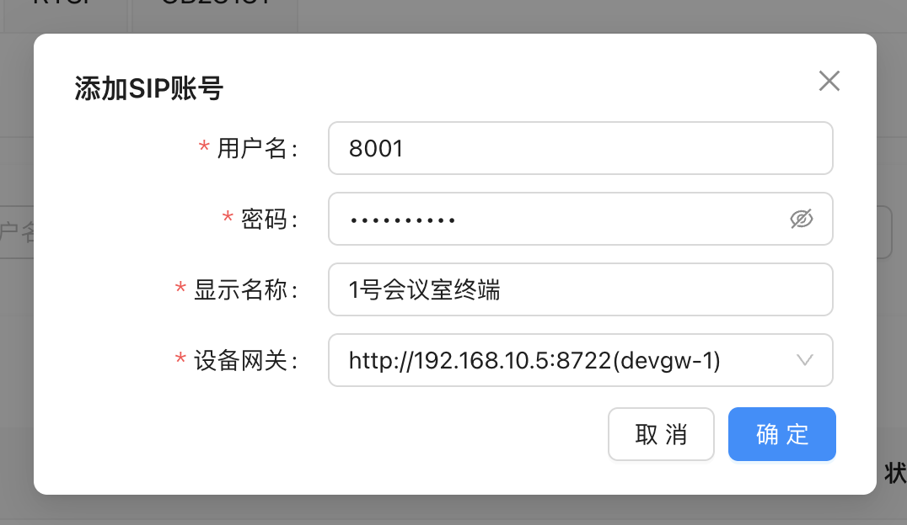
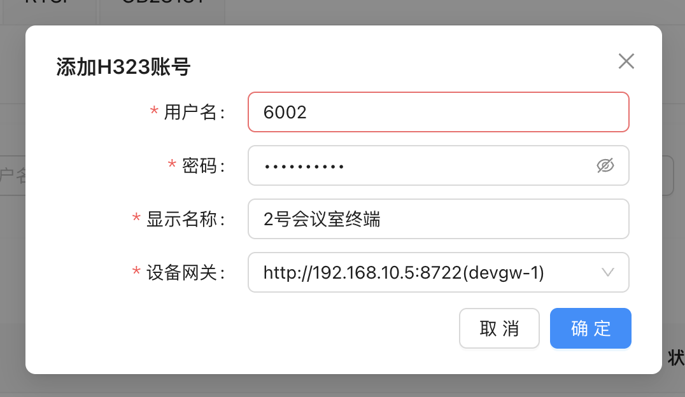
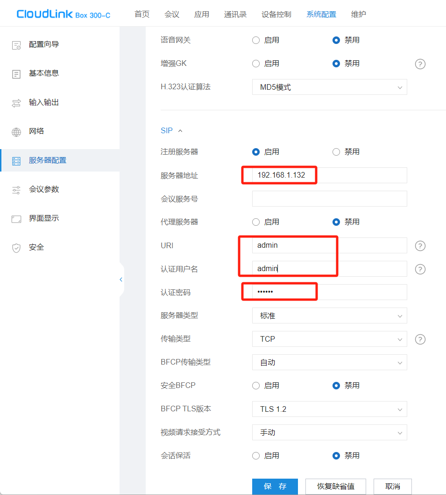
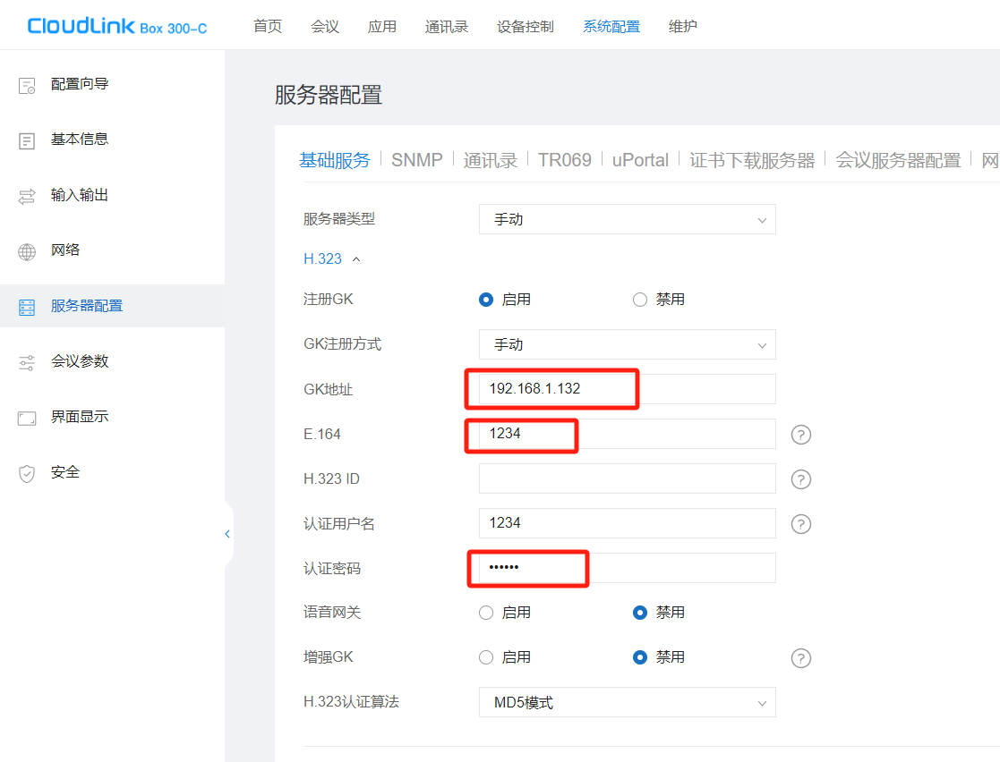
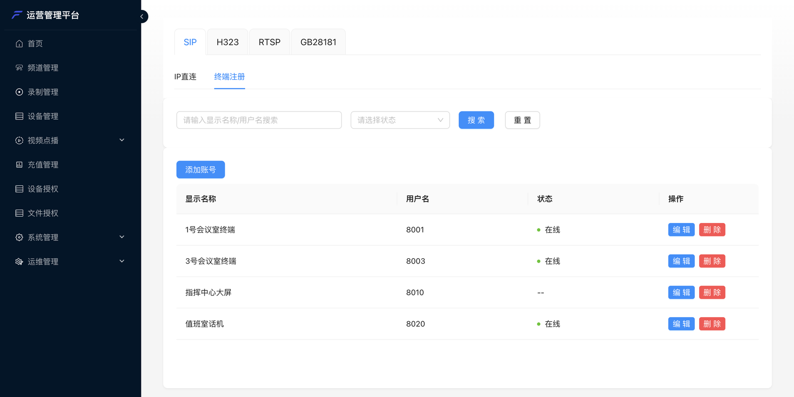
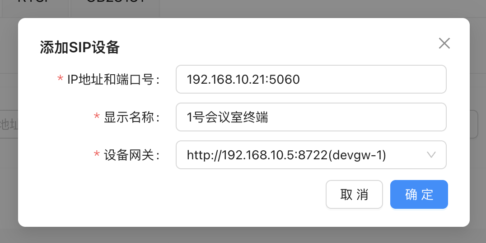
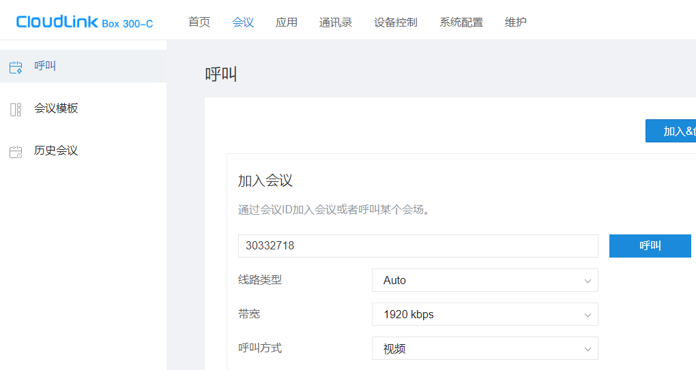
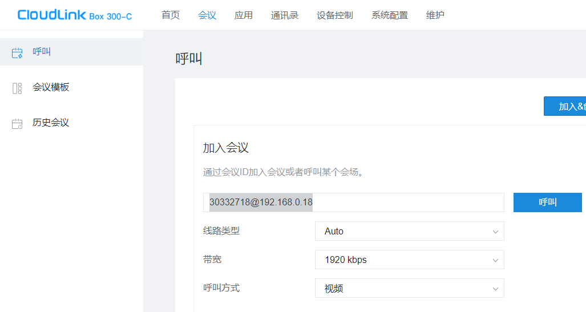
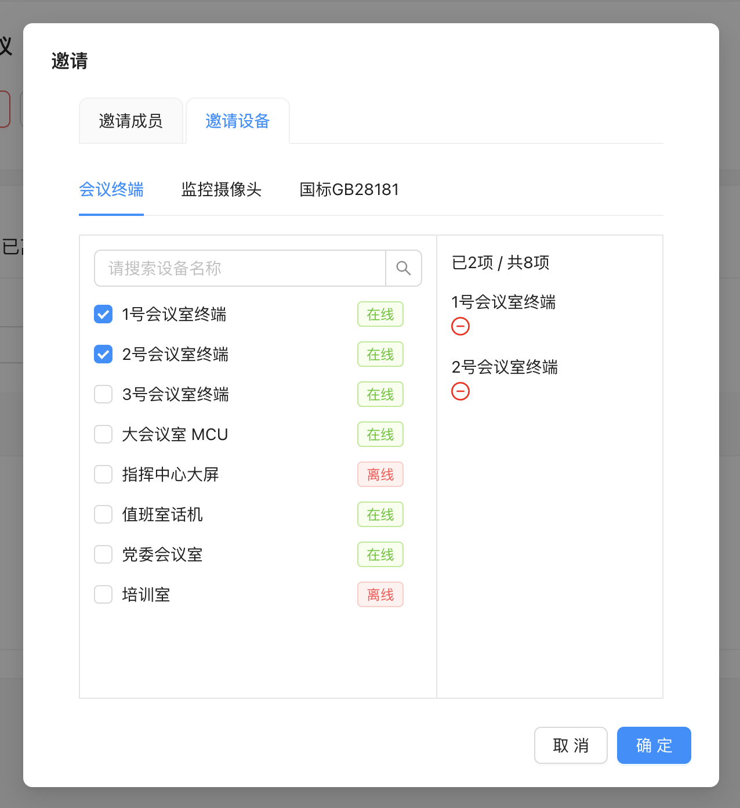
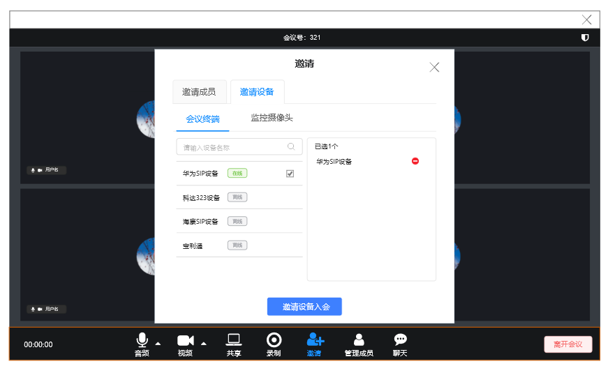

本篇以华为 CloudLink 终端为例，其他品牌菜单名不同，但要填的东西是一样的。动手前先看一眼
[设备接入概览](/zh/product/device-access/overview)，弄清「终端注册」和「IP 直连」该选哪个。

**准备好这些信息**：

| 信息 | 从哪拿 | 示例 |
| --- | --- | --- |
| 设备网关地址 | 部署时填的「设备访问网关 IP」，问部署人员 | `192.168.10.5` |
| SIP 端口 | 默认 5060 | `5060` |
| H.323 网守端口 | 默认 1719 | `1719` |
| 管理后台账号 | 平台管理员 | — |

---

## 方式一：终端注册（推荐）

终端用一个账号注册到设备网关，平台就能看到它在不在线，拨号也只需要会议号。

### 1. 在管理后台建账号

打开管理后台 **设备管理**，选 **SIP**（或 **H323**）标签 → **终端注册** → **添加账号**：

| 字段 | 填什么 |
| --- | --- |
| 用户名 | 终端注册用的账号。**H.323 只能填数字**（就是终端的 E.164 短号），SIP 不能含冒号 |
| 密码 | 终端注册时的认证密码 |
| 显示名称 | 终端进会后显示的名字，比如「1 号会议室」 |
| 设备网关 | 终端注册到哪个网关。只有一个网关就选它 |

H.323 的弹窗字段相同：

### 2. 在终端上填注册信息

**SIP 终端**：找到 SIP 服务器（注册服务器）配置，启用注册，填：

| 终端上的字段 | 填什么 |
| --- | --- |
| 服务器地址 / 注册服务器 | 设备网关地址 |
| 端口 | 5060 |
| URI / 用户名、认证用户名 | 后台建的「用户名」 |
| 认证密码 | 后台建的「密码」 |
| 传输类型 | UDP 或 TCP 均可 |

**H.323 终端**：找到网守（GK）配置，启用注册，填：

| 终端上的字段 | 填什么 |
| --- | --- |
| GK 地址 | 设备网关地址（端口 1719） |
| E.164 号码 | 后台建的「用户名」（数字） |
| 认证用户名 / 密码 | 后台建的「用户名」和「密码」 |

### 3. 确认在线

终端一般会提示「注册成功」。回到管理后台，账号状态变成 **在线** 就说明注册上了：

注册不上？见[常见问题](/zh/product/device-access/faq#终端注册不上)。

---

## 方式二：IP 直连

终端不支持注册、或者有固定 IP 时用这种方式。平台要能直接访问到终端的 IP。

在 **设备管理** → **SIP**（或 **H323**）→ **IP 直连** → **添加设备**：

| 字段 | 填什么 |
| --- | --- |
| IP 地址和端口号 | 终端的 `IP:端口`。SIP 一般是 `:5060`，H.323 一般是 `:1720` |
| 显示名称 | 终端进会后显示的名字 |
| 设备网关 | 由哪个网关去呼叫这台终端 |

IP 直连的设备没有在线状态，列表里显示 `--` 是正常的。

---

## 让终端进会

### 终端主动拨号

在终端的呼叫界面里输入号码，像打电话一样呼叫：

**已注册的终端**：只拨**会议号**。

**未注册的终端**：拨 **`会议号@设备网关地址`**。

呼通后终端直接进入会议，看到的是整场会议的合成画面。

<Note>
设备网关可以开启**来电 IP 白名单**，开启后只有名单里的终端能呼入。部署时按需配置，呼入被拒可以先问问部署人员是否开了白名单。
</Note>

### 平台邀请终端

终端会收到来电，接听后进会（终端设置了自动应答则直接进会）。三个入口：

**管理后台**：**会议管理** → 进入会议详情 → **邀请** → **邀请设备** → **会议终端**，勾选后确定。

**会议客户端**：主持人在会中点 **邀请** → **邀请设备**，勾选终端后发起邀请。

**业务系统调接口**：调用[邀请设备入会](/zh/rtc/server-api/agent#邀请设备入会)，接法见[设备接入指南](/zh/rtc/server-api/guides/agents)。
会议 SDK 的主持人端也有对应方法（如 Web 的 `adminInviteAgent`）。

---

## 会中

+ 终端是会里的一名成员，名字就是「显示名称」
+ 终端看到的是 **MCU 合成的整场画面**，听到的是整场混音
+ 主持人可以在会议客户端或后台**开关终端的麦克风和摄像头**、把终端**移出会议**；移出会议即挂断终端
+ 终端自己挂断，就是离开会议

---

## 终端注册到第三方平台

如果客户已经有自己的 SIP 服务器或 H.323 网守，设备网关也可以**作为一个终端注册上去**，
和那边的设备互相呼叫。这需要在部署时配置，请联系我们。
