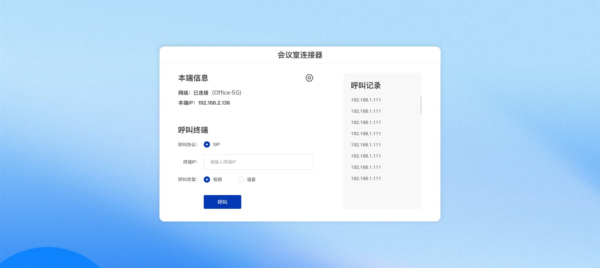
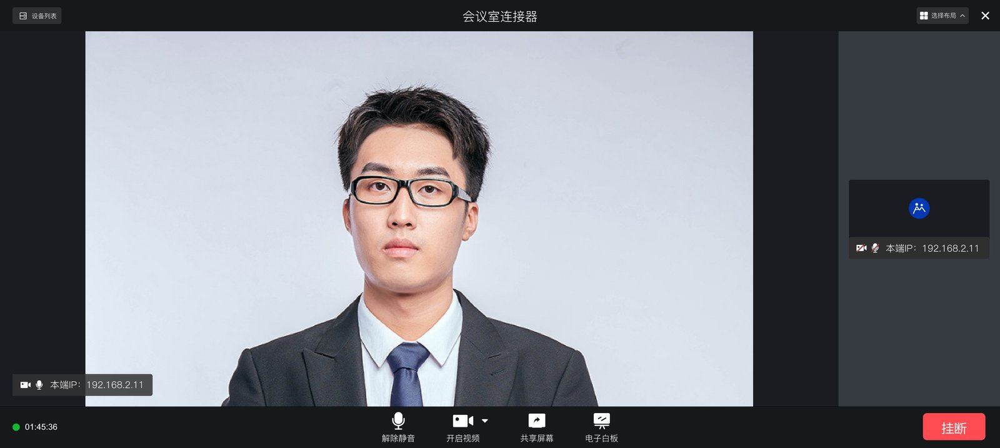
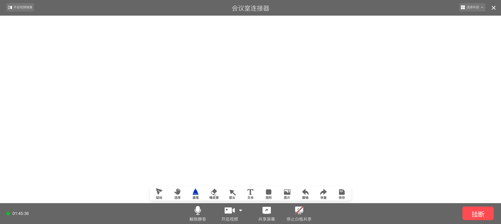
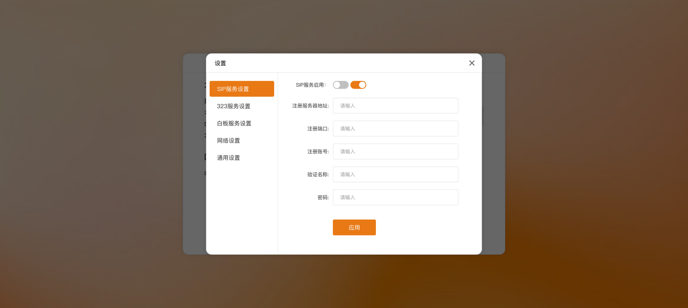

**软 SIP / H.323 终端**是一款安卓 App（App 内标题为「会议室连接器」）。装到会议室的安卓大屏、一体机或盒子上，这台设备就成了一台
**标准的 SIP / H.323 视频会议终端**——不用再单独采购硬件终端，就能和华为、科达等品牌的会议终端、
MCU 互相呼叫，也能接入我们的会议平台。

---

## 适合的场景

+ 会议室已经有安卓大屏 / 一体机，想低成本接入现有的 SIP / H.323 视频会议系统
+ 显示墙、指挥大屏需要作为一个终端加入上级单位的视频会议
+ 和我们的会议平台一起用：注册到设备网关后拨会议号入会，见[设备接入](/zh/product/device-access/sip-h323)

---

## 主要功能

| 功能 | 说明 |
| --- | --- |
| **点对点呼叫** | 选择 SIP 或 H.323，输入对方终端的 IP、E.164 号码或名称即可呼叫；可选音视频或纯语音 |
| **来电接听** | 来电弹窗接听 / 拒绝，可设置**自动接听**，适合无人值守的大屏 |
| **注册** | 可注册到 SIP 服务器、H.323 网守，支持 H.460 NAT 穿越 |
| **会中控制** | 静音、开关视频、切换摄像头、画面镜像、大小画面 / 等分布局 |
| **屏幕共享** | 发起与接收共享（H.323 呼叫下可用） |
| **电子白板** | 会中发起白板或输入服务码加入，支持画笔、文本、图形、撤销、保存 |
| **呼叫记录** | 一键重拨 |

**会中画面**：

**电子白板**：

---

## 使用流程

1. 安装 App 并完成**软件激活**（激活信息由我们提供）
2. 在 **设置** 中按需配置：

   | 设置页 | 内容 |
   | --- | --- |
   | SIP 服务 | 是否注册、服务器地址、端口、账号、密码 |
   | 323 服务 | 网守地址、E.164 号码、H.460 NAT 穿越、端口 |
   | 白板服务 | 白板服务器地址 |
   | 网络 | 本机网络信息 |
   | 通用 | 显示名称、自动接听、获取日志 |

   

3. 回到首页，选协议、输入对方地址，点 **呼叫**；或等待对方来电

接入我们的会议平台时，把 SIP / 323 服务指向设备网关（账号在管理后台创建），之后在首页拨**会议号**即可入会，
步骤与[硬件终端](/zh/product/device-access/sip-h323)完全相同。

---

## 获取

软终端按项目交付，**安装包与激活请[联系我们](https://www.stmlink.com/contact)**。
