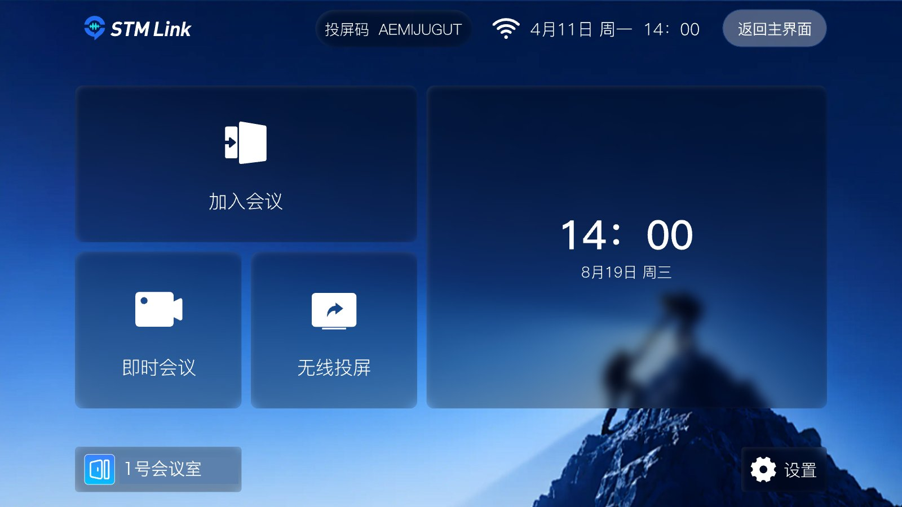
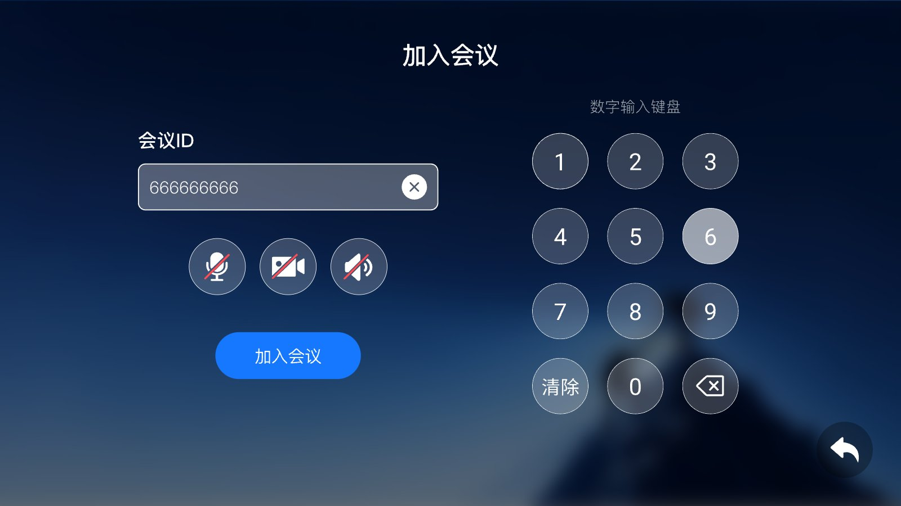
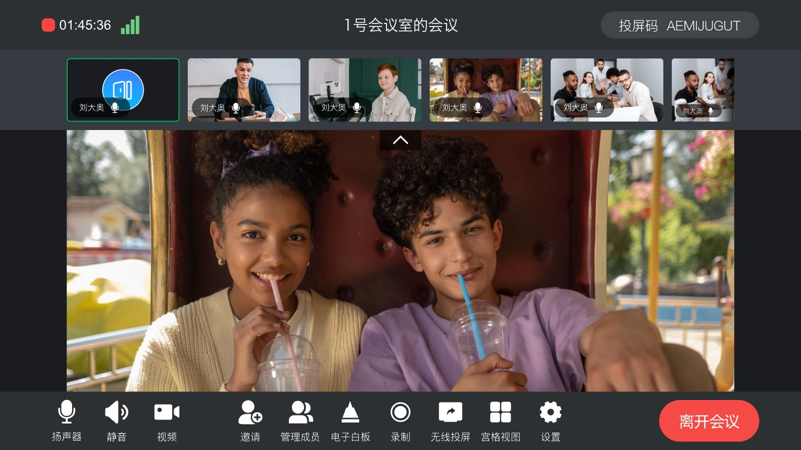

**STM Link Rooms** 是我们会议产品的大屏版。装在会议室的安卓电视或大屏上，用**遥控器**就能完成入会、开会、投屏，
和手机、电脑上的参会人开同一场会。

---

## 为会议室设计

| 特点 | 说明 |
| --- | --- |
| **遥控器操作** | 全部界面支持遥控器焦点移动，自带大屏数字键盘和全键盘 |
| **会议室账号** | 一台大屏绑定一个会议室账号，开机即在线，不依赖个人手机 |
| **三个入口** | 首页只有「加入会议」「即时会议」「无线投屏」三张大卡片，一眼可见 |
| **横屏固定** | 专为 16:9 大屏排版，远距离也看得清 |

---

## 主要功能

**加入会议**：输入会议号，入会前可以先开关麦克风、摄像头、扬声器；会议有密码时提示输入。

**即时会议**：输入会议名称直接开会，会中可以把会议号和二维码展示给其他人加入。

**无线投屏**：首页和顶栏常驻**投屏码**，参会人在手机上打开 STM Link，点「无线投屏」输入投屏码，就能把手机画面投到大屏上。

**会中**：

| 功能 | 说明 |
| --- | --- |
| 音视频 | 麦克风、扬声器、摄像头开关 |
| 布局 | 宫格（可翻页）、演讲者、缩略图三种视图 |
| 邀请 | 展示会议号、密码和入会二维码 |
| 成员管理（主持人） | 改名、静音 / 解除静音、开关视频、停止共享、移出会议、全员静音 |
| 电子白板 | 会中发起白板协作 |
| 云录制 | 一键开始 / 停止录制 |
| 质量检测 | 查看网络、音频、视频、共享的码率、帧率、丢包、延时 |

**设置**：入会时默认开启麦克风 / 摄像头 / 扬声器、语音激励，摄像头与麦克风、扬声器选择，版本检查更新。

---

## 和其他终端的关系

| 终端 | 适合 |
| --- | --- |
| **STM Link Rooms** | 会议室大屏，用我们的会议平台开会 |
| [软 SIP / H.323 终端](/zh/product/terminals/softsip) | 安卓大屏要作为 SIP / H.323 终端，接入第三方视频会议系统 |
| [硬件视频终端接入](/zh/product/device-access/sip-h323) | 会议室已有华为、科达等硬件终端 |

---

## 获取

STM Link Rooms 基于 [SMeeting 会议 SDK](/zh/meeting/overview) 构建，按项目交付，
**安装包与会议室账号请[联系我们](https://www.stmlink.com/contact)**。
